# LendLoop — neighbourhood tool lending with automated workflows

**Borrow what you need. Lend what you don't.** A take-home assignment for **Fluence International (Full-Stack Developer)**.

**▶ Live app: https://lendloopapp.vercel.app** · n8n: https://looplend-n8n.onrender.com · Project document: [`docs/LendLoop-Project-Document.md`](docs/LendLoop-Project-Document.md) ([.docx](docs/LendLoop-Project-Document.docx))

`Next.js 16 (App Router)` · `React 19` · `TypeScript (strict)` · `Clerk` · `Convex` · `n8n (Docker)` · `Mapbox GL` · `SCSS modules` · `Vitest` · `Playwright` · `GitHub Actions → Vercel · Convex · Render`

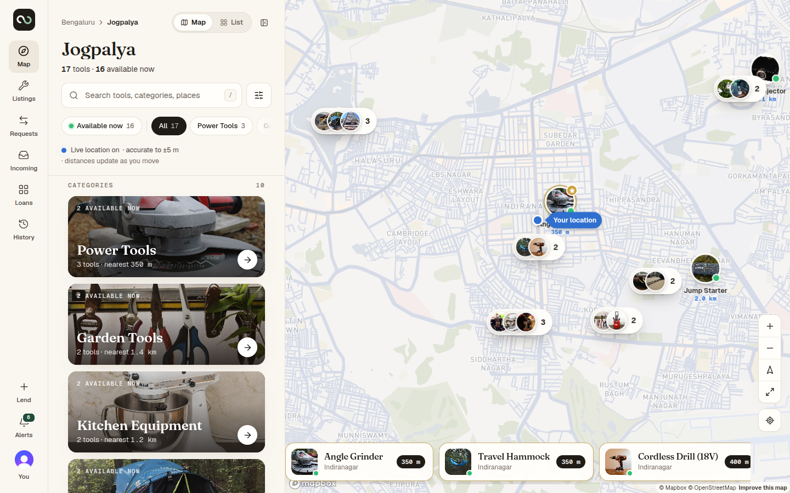

## At a glance

Neighbours list tools they rarely use; others find them on a map, request dates, hand over in person with a one-time code, return with a second code, and review each other. **Every rule is enforced in Convex, not the UI.** n8n delivers the notifications and the daily overdue reminders over **HMAC-signed, idempotent, retried** webhooks, and every delivery is visible on the loan itself.

**Try it in 60 seconds** — sign in at https://lendloopapp.vercel.app/sign-in with a demo account and the verification code **`424242`** (Clerk test mode):

| Role in the demo | Email | Code |
| --- | --- | --- |
| Lender | `lendloop.owner+clerk_test@example.com` | `424242` |
| Borrower | `lendloop.borrower+clerk_test@example.com` | `424242` |

Use two browsers (or a private window): list a tool as the lender, request it as the borrower, approve, then read the pickup code from the borrower's screen into the lender's.

### Assessment checklist

| Requirement | Status | How / where |
| --- | --- | --- |
| Public page: LendLoop, tagline, tools from Convex, no owner details | ✅ | `src/components/landing/Landing.tsx`, `tools.publicPreview` (no owner fields; locations fuzzed ~500 m) |
| "Sign in to lend or borrow" wired to Clerk | ✅ | Landing CTA → Clerk `<SignIn>` (sign-in-or-up) |
| List a tool (name, category, condition, description) | ✅ | `src/features/listings/ToolForm.tsx` → `tools.create` (+ photos, pickup point, terms) |
| Request a date range · approve / decline · mark returned | ✅ | `requests.create/approve/decline`; return confirmed with a one-time code (`otpActions.verifyCode`) |
| All tools with availability, filterable by category | ✅ | Explore: map **and** list view, category index + chips, filters (`src/features/discovery`) |
| My listings · My requests · Incoming requests | ✅ | `/listings`, `/requests`, `/incoming` |
| Roles: admin (remove any listing, view all loans, Trusted Lender) · user (own listings, own requests) | ✅ | `convex/admin.ts` (`requireAdmin`), ownership + `loanRoleOf` checks in every function; no client path to ADMIN |
| n8n workflow A: request notification on create / status change | ✅ | Convex outbox → signed webhook → `n8n/workflows/lendloop-request-notification.json` |
| n8n workflow B: daily overdue reminders, write-back to Convex | ✅ | `lendloop-overdue-reminders.json` ↔ `/automation/overdue/candidates`, `/automation/reminders/*` |
| HMAC both directions · secrets only in env / n8n credentials | ✅ | `convex/lib/crypto.ts`, `convex/http.ts`; workflow JSON contains no secrets |
| Idempotent write-backs · retries · error workflow | ✅ | `eventId` / `reminderKey` dedup, nonce replay protection, backoff 30 s → 2 h → DEAD, `lendloop-error-handler.json` |
| (Bonus) Automation activity on each loan | ✅ | Loan page "Automation" card (`loans.automationActivity`) |
| README: setup, docker-compose, env vars, architecture, security & data minimisation, production note | ✅ | Sections [14](#14-local-development)–[16](#16-docker-compose-n8n), [3](#3-architecture), [9](#9-location-privacy), [19](#19-production-readiness) |

### Highlights

- **Privacy by design.** Other members only ever see a first name + last initial; no email, phone or address is shown to anyone. Everyone sees a **fuzzed (~500 m) location**; the **exact pickup point** lives in a separate table and is revealed **only to the approved borrower** of that loan.
- **Authorisation in the backend.** Every Convex function re-derives the user from the Clerk JWT, checks ownership or loan participation (non-participants get `null`/`NOT_FOUND`, not "forbidden"), and role changes are server-only and audited.
- **Verified hand-overs.** Pickup and return codes are HMAC-hashed with a pepper, expire, are single-use, attempt- and rate-limited, and only the owner can verify.
- **Reliable automation.** Transactional outbox, signed webhooks with timestamp + nonce replay protection, claim/report idempotency, exponential retries, an error workflow, and per-loan delivery history.
- **Tested end to end.** 139 unit + Convex integration tests; a Playwright run where two browsers complete the full lifecycle — run against the **live** site; CI on every push, CD to Vercel / Convex / Render with smoke tests.

### Screenshots

| Public landing (no owner details) | List view with inline filters |
| --- | --- |
| 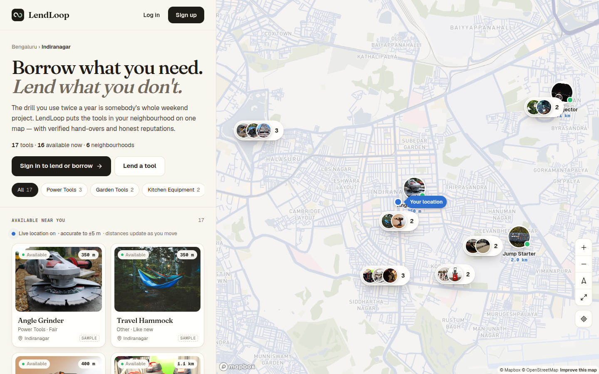 | 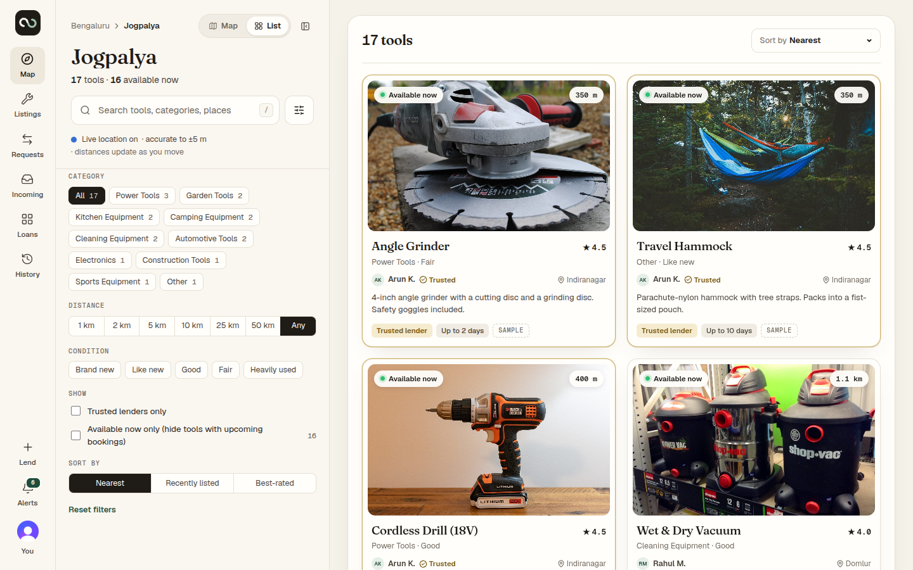 |
| **Tool detail (approximate area only)** | **Borrow request** |
| 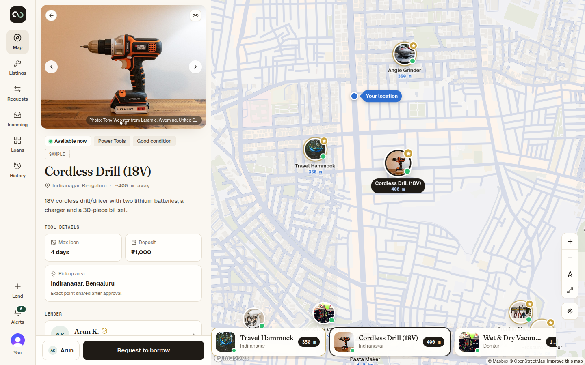 | 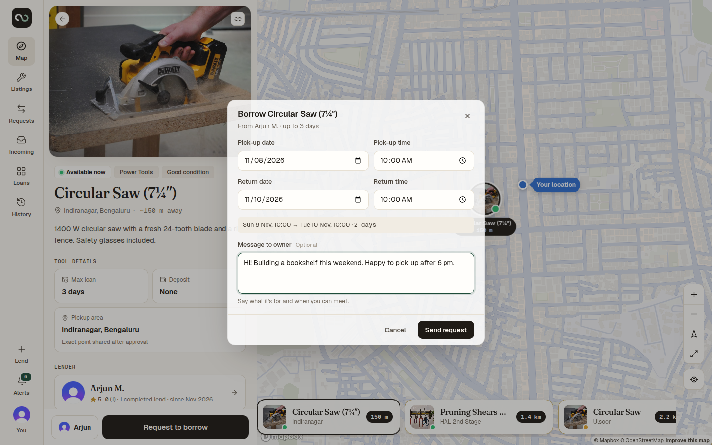 |
| **Incoming request (owner)** | **Loan: exact pickup point, code, automation activity** |
| 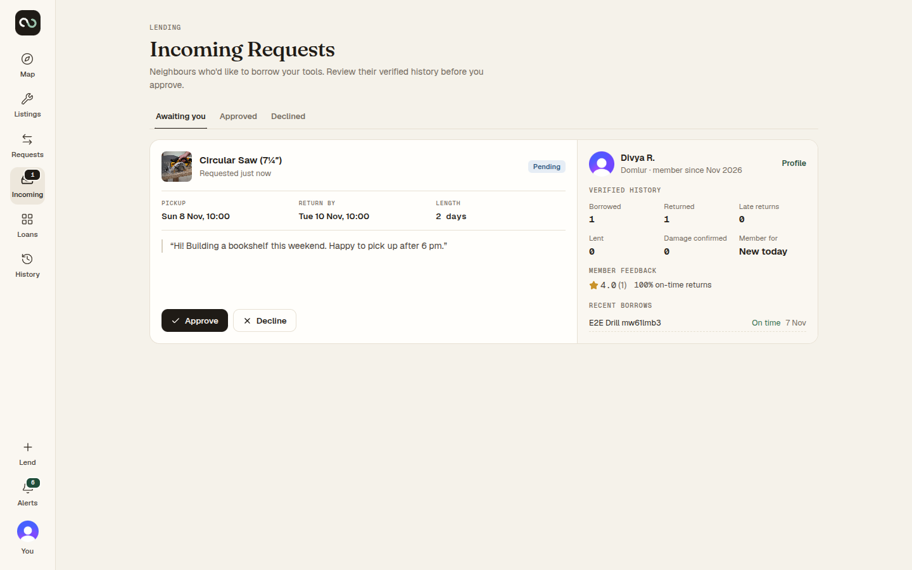 | 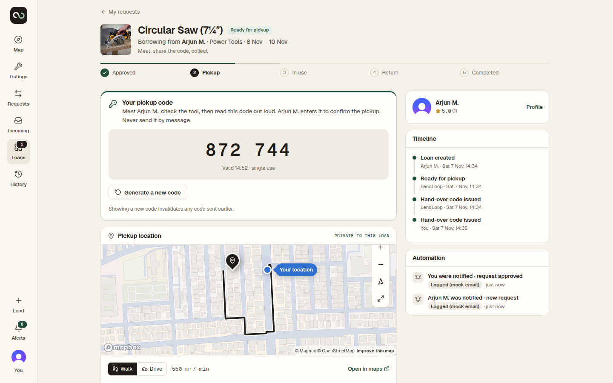 |
| **Owner verifies the hand-over code** | **Mobile** |
| 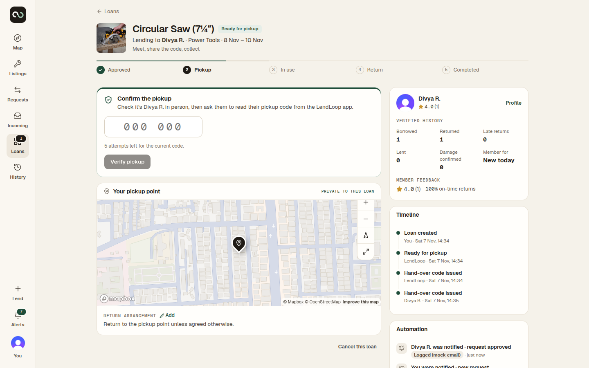 | 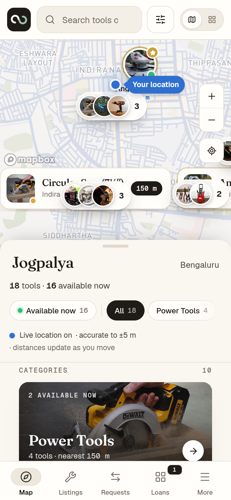 |
| **n8n · Request notification** | **n8n · Daily overdue reminders** |
| 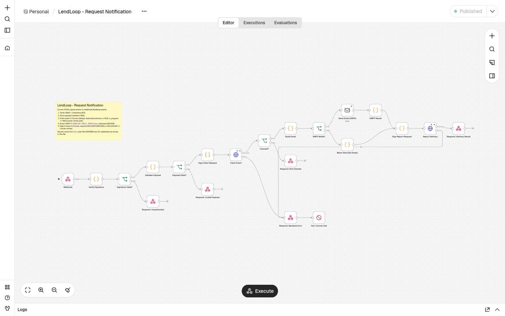 | 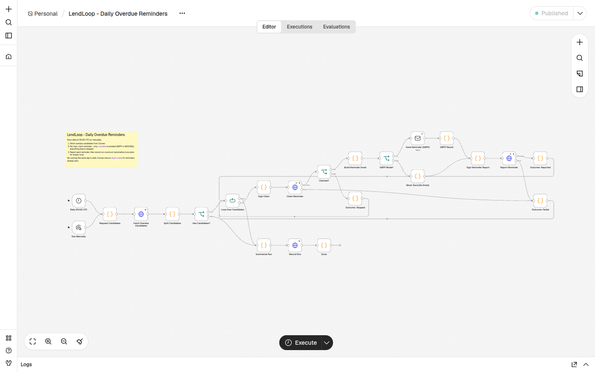 |

## Live deployment

| Piece | URL | Hosting (free tier) |
| --- | --- | --- |
| Website | **https://lendloopapp.vercel.app** | Vercel Hobby |
| Backend | `https://acrobatic-alpaca-862.eu-west-1.convex.cloud` (health: [`/health`](https://acrobatic-alpaca-862.eu-west-1.convex.site/health)) | Convex Free, production deployment |
| Automation | https://looplend-n8n.onrender.com | n8n on Render Free + Render Postgres |
| Sign-in | Clerk development instance | Clerk Hobby |
| CI/CD | GitHub Actions: [`ci.yml`](.github/workflows/ci.yml), [`deploy.yml`](.github/workflows/deploy.yml) | every push to `main` deploys Convex → Vercel → (n8n) → smoke test |

**Documentation**

| Document | What it covers |
| --- | --- |
| [`docs/ARCHITECTURE.md`](docs/ARCHITECTURE.md) | The system in depth: topology, how a request is authenticated, **a sequence diagram and step list for every operation** (sign-in, discovery, listings, requests, loan state machine, OTP hand-overs, reviews, notifications, n8n workflows, crons, admin), data model, every function and route, security, configuration, CI/CD |
| [`docs/PRODUCTION.md`](docs/PRODUCTION.md) | Operating the live deployment: what's live, what to click in each dashboard (Google sign-in, Clerk, Mapbox, rotating keys), free-tier limits, moving n8n's database before it expires, going fully production with a domain |
| [`docs/DEPLOY.md`](docs/DEPLOY.md) | Deploying from scratch on free tiers (Vercel, Convex, Render/Oracle for n8n), and why Render Free can't send SMTP |
| [`docs/CONVEX_SETUP.md`](docs/CONVEX_SETUP.md) · [`docs/N8N_SETUP.md`](docs/N8N_SETUP.md) | Backend and automation setup for local development |

---

## Contents

1. [Features](#1-features)
2. [Tech stack](#2-tech-stack)
3. [Architecture](#3-architecture)
4. [Database design](#4-database-design)
5. [Authentication](#5-authentication)
6. [Authorisation model](#6-authorisation-model)
7. [Loan lifecycle](#7-loan-lifecycle)
8. [OTP security](#8-hand-over-otp-security)
9. [Location privacy](#9-location-privacy)
10. [n8n integration](#10-n8n-integration)
11. [Webhook security](#11-webhook-security)
12. [Idempotency](#12-idempotency)
13. [Failure handling](#13-failure-handling)
14. [Local development](#14-local-development)
15. [Environment variables](#15-environment-variables)
16. [Docker Compose (n8n)](#16-docker-compose-n8n)
17. [Testing](#17-testing)
18. [Deployment](#18-deployment)
19. [Production readiness](#19-production-readiness)
20. [Known limitations](#20-known-limitations)

---

## 1. Features

**Discovery (map first)**
- Full-bleed vector map: **Mapbox GL + Mapbox Standard** (faded theme, globe zoom-out) when a token is set, otherwise MapLibre GL with an open OpenStreetMap basemap. Circular product-photo pins have an availability dot, a gold ring for trusted lenders and a name label. Clusters show stacked thumbnails. There is a selected-pin state, a current-user dot, a radius ring, a featured-card carousel over the map, and zoom / north / fullscreen / locate controls.
- Two-way sync between list and map. Clicking a list item flies the map to the marker (offset for the detail panel). Clicking a marker scrolls the list and opens the details.
- Search by tool name or category (Convex full-text search index), by place (geocoding proxy), and by distance radius. Filters: category, distance, condition, trusted lenders, availability. Sort: nearest, recent, best-rated.
- First-visit location explainer. The browser permission prompt appears only after the user presses *Use my location*. If location is denied or unavailable, the user can search for a place manually or browse without GPS.
- Responsive layouts:
  - Desktop: icon rail, list panel, map, floating detail panel.
  - Tablet: collapsible list panel.
  - Mobile: full-screen map, draggable three-snap bottom sheet and tab bar.

**Lending and borrowing**
- Listing management: create, edit, pause/resume, delete, multiple photos, a private pickup pin chosen on a map, max loan length, availability window, instructions, conditions and deposit note.
- Borrow requests are validated on the server: no past dates, return after pickup, max length, availability window, no requesting your own tool, no duplicate pending requests, and no overlap with approved loans.
- Owners see each borrower's **verified** history (borrowed, returned, late, damage confirmed, account age), member feedback, and **unverified** claims shown separately. Owners can approve, or decline with an optional reason.
- Approval is atomic: it re-checks every condition, creates the loan, and auto-declines any overlapping pending requests.
- Full loan state machine: pickup OTP → active → overdue → return with photo → return OTP → completed. Side paths: cancellation, damage reporting (acknowledge/contest), not-returned disputes, and admin resolution.
- The exact pickup point, address, a walking/driving route and turn-by-turn directions are revealed only to the approved participants of that loan.
- Two-sided feedback with rating, tags and comment. It is allowed once per participant per completed loan. Reviewees can report abusive reviews.

**Platform**
- Live everywhere through Convex subscriptions: map availability, request and loan status, notifications, badges.
- In-app notification dropdown and centre, with mark-read and mark-all-read.
- Email notifications through **n8n**: signed webhooks, deduplication, retries, error workflow, and a daily overdue-reminder workflow.
- Admin panel with these sections: overview, users (trusted lender, suspend/reinstate), listings (remove/restore), loans, disputes, damage review, reported feedback, automation health (retry dead events), and the audit log.
- Seed data and a development mock mailbox, both clearly labelled.

## 2. Tech stack

| Layer | Choice |
| --- | --- |
| Frontend | Next.js 16 (App Router), React 19, TypeScript (strict, `noUncheckedIndexedAccess`) |
| Styling | SCSS modules with CSS custom-property design tokens. No Tailwind. |
| Forms | React Hook Form + Zod (client); the Convex validators + domain rules are authoritative |
| Server state | Convex React hooks (live queries). TanStack Query only for the geocoding/routing HTTP proxies. |
| Map | MapLibre GL JS 6 (mapcn-style React components: portal markers, context-provided map) + Supercluster; custom LendLoop style on OpenFreeMap vector tiles (no API key); Nominatim geocoding and OSRM routing behind server proxies. All URLs are env-configurable. |
| Backend | Convex: schema, queries, mutations, actions, HTTP actions, crons, file storage |
| Auth | Clerk (Core 3) → Convex JWT (`convex` template / Clerk's Convex integration) |
| Automation | n8n 2.46 (Docker Compose), HMAC-signed webhooks both ways |
| Email | Delivery abstraction: `mock` (dev mailbox) or `smtp` (Nodemailer in a Convex Node action); notification email through n8n |
| Tests | Vitest (unit, plus Convex integration via `convex-test`), Playwright + `@clerk/testing` (E2E) |

**Why no Socket.IO?** Convex queries are already reactive subscriptions over a WebSocket, and they are transactionally consistent with the mutations that change state. A second real-time channel would duplicate this and could disagree with the database. All live UI (map availability, request/loan status, notifications, OTP state) is driven by Convex.

**Why Cache Components are off.** Next 16 enables Cache Components by default. LendLoop is predominantly client-rendered (live Convex data, MapLibre), and auth is read at request time. Static shell caching adds complexity with little benefit here (`next.config.ts`).

**Map and design direction.** The map-first layout takes its spatial language from startupmap.one:
- an icon rail;
- a list panel with a serif area title, search, filters and category chips, which turns into the detail view in place;
- a full-bleed map with large circular image pins and a card carousel.

**Map engine.**
- **With `NEXT_PUBLIC_MAPBOX_TOKEN`** (recommended): Mapbox GL JS v3 with the Mapbox Standard style — the same base-map family startupmap.one uses. It is configured in `src/components/map/mapEngine.ts`:
  - faded theme with sampled land and water colours;
  - no POI, road or transit labels and no 3D objects;
  - a **globe** you can zoom all the way out to, where clusters become region pills such as "Bengaluru · 17 tools".
- **Without a token:** MapLibre GL with the open LendLoop style (`lendloopStyle.ts`) on OpenStreetMap data from OpenFreeMap, also with globe projection. No account is needed.

Both engines share the same React components (portal markers, Supercluster clustering, GeoJSON layers), so the rest of the app is engine-agnostic. The MapLibre worker is self-hosted from `public/vendor/` (copied on install, dev and build), and the CSP allows only the map hosts in use.

## 3. Architecture

```mermaid
flowchart LR
  subgraph Browser
    UI[Next.js app<br/>React + SCSS + MapLibre GL]
  end
  subgraph Next[Next.js server]
    PX[proxy.ts<br/>clerkMiddleware]
    L[(authenticated)/layout<br/>server auth() guard]
    API[/api/geocode<br/>/api/directions/]
  end
  Clerk[(Clerk)]
  subgraph Convex
    Q[Queries / Mutations<br/>RBAC + state machine]
    A[Actions<br/>OTP · outbox delivery · SMTP]
    H[HTTP actions<br/>/automation/*]
    C[Crons<br/>overdue · expiry · housekeeping]
    DB[(Database + File storage)]
  end
  N8N[n8n<br/>A: notifications<br/>B: overdue reminders<br/>C: error handler]
  OSM[(OpenFreeMap vector tiles · Nominatim · OSRM)]

  UI -- sign in --> Clerk
  UI -- JWT + WebSocket subscriptions --> Q
  UI -- actions --> A
  UI --> API --> OSM
  UI -- tiles --> OSM
  Q --> DB
  A --> DB
  Q -- outbox + scheduler --> A
  A -- HMAC-signed webhook --> N8N
  N8N -- HMAC-signed calls --> H --> DB
  C --> DB
```

Request flow for a state change, using "approve" as the example:
1. The client calls `requests.approve`.
2. The Convex mutation verifies the identity, ownership, request state, borrower state, listing state and calendar conflicts in one serialisable transaction.
3. In the same transaction it writes the loan, the audit events, the notifications and an **outbox** row.
4. It schedules the OTP issuance action and the n8n delivery action.
5. Every subscribed client updates instantly.

### Project layout

```
convex/                 Backend (deployed to Convex)
  schema.ts             Tables, indexes, search index
  users.ts tools.ts requests.ts loans.ts feedback.ts notifications.ts admin.ts
  otp.ts otpActions.ts  OTP persistence (internal) + generation/verification (actions)
  automation.ts http.ts n8n outbox delivery + signed inbound endpoints
  email.ts emailNode.ts devMailbox.ts   Email abstraction (mock | smtp)
  scheduled.ts crons.ts Time-based transitions and housekeeping
  seed.ts files.ts
  lib/                  Pure domain logic shared with the UI (state machine, rules, geo, crypto) + server helpers (auth, audit, notify, rate limit, projections)
  validators/           Convex validators built from shared constants
src/
  app/(public)          Landing, sign-in, sign-up
  app/(authenticated)   explore, listings, requests, incoming, loans, history, notifications, profile, users, admin, onboarding, dev/mailbox, more
  app/api               geocode + directions proxies
  components/           common, layout, map, tools, loans, profile, landing, brand
  features/             authentication, discovery, listings, borrowing, lending, feedback, admin
  hooks/ lib/ services/ styles/
n8n/                    Workflow exports, scripts, README
tests/unit · tests/integration · tests/e2e
```

## 4. Database design

All IDs are Convex IDs. Every table has `createdAt`/`updatedAt` or an equivalent event time. Seed rows carry `isSeed: true`.

| Table | Purpose | Key indexes |
| --- | --- | --- |
| `users` | Profile synced from Clerk; role, status, trusted flag; denormalised reputation `stats` (updated transactionally) | `by_token`, `by_email`, `by_role`, `by_status`, `by_seed` |
| `tools` | Public listing with **approximate** coordinates only; derived `status` + `discoverable` | `by_owner`, `by_status`, `by_discoverable_lat` (geo range scan), `by_discoverable_created`, search index `search_text` (filters: discoverable, category) |
| `toolPickupLocations` | **Exact** pickup point and address, in a separate table so no tool query can leak them | `by_tool` |
| `borrowRequests` | PENDING / APPROVED / DECLINED / CANCELLED / EXPIRED | `by_borrower_status`, `by_owner_status`, `by_tool_status`, `by_borrower_tool_status`, `by_status_pickup` |
| `loans` | Lifecycle state machine, timestamps, tool snapshot, dispute outcome | `by_borrower_status`, `by_owner_status`, `by_tool_status`, `by_status_returnBy`, `by_status_pickup`, `by_status`, `by_request` |
| `otpVerifications` | HMAC **hash** of each code, expiry, attempts, status | `by_loan_purpose_status`, `by_loan` |
| `returnSubmissions` | Borrower's return photos and notes | `by_loan` |
| `damageReports` | Evidence, borrower response, admin resolution | `by_loan`, `by_subject`, `by_status` |
| `feedback` | One per author per loan; VISIBLE / REPORTED / HIDDEN | `by_loan_author`, `by_subject`, `by_status` |
| `userReports` | Reports against feedback (admin queue) | `by_status`, `by_reporter_target` |
| `notifications` | In-app notifications | `by_user`, `by_user_read` |
| `auditLogs` | Who, what, which resource, from→to status, sanitised metadata | `by_resource`, `by_actor`, `by_action` |
| `automationEvents` | Outbox for n8n: delivery status, attempts, n8n claim and report | `by_event_id`, `by_status`, `by_loan` |
| `automationReminders` | Overdue reminder ledger (one per loan per day) | `by_key`, `by_loan` |
| `webhookEvents` | Inbound request nonces (replay protection) | `by_nonce`, `by_received` |
| `automationFailures` / `automationRuns` | n8n error-workflow records and run summaries | `by_status` / `by_workflow` |
| `uploads` | File ownership ledger (storage IDs appear in public URLs) | `by_storage`, `by_owner`, `by_attached_created` |
| `rateLimits` | Fixed-window counters | `by_key` |
| `devMailbox` | Mock email (development only, 24 h TTL) | `by_user` |

Relationships: User → Tools / Requests / Loans / Notifications; Tool → Requests / Loans; Loan → Feedback / Return submissions / Damage reports / Automation events / OTPs.

**Sensitive fields never leave the server by accident.** Queries return explicit projections (`convex/lib/projections.ts`) rather than raw documents. Public listings expose an allow-listed set of fields; this is checked by `tests/integration/privacy.test.ts`.

## 5. Authentication

- **Clerk** handles sign-up, sign-in, sessions, email/phone verification and account security (`UserProfile`, opened from the Profile page).
- **Convex** validates Clerk-issued JWTs (`convex/auth.config.ts`, issuer `CLERK_JWT_ISSUER_DOMAIN`, audience `convex`). `ConvexProviderWithClerk` supports the `convex` JWT template and Clerk's native Convex integration.
- **Profile sync:** after sign-in the client calls `users.ensureCurrent`. It creates or refreshes the Convex user from the verified token claims: name, email, avatar, and the phone number only if it is verified. The role is always `USER` on creation.
- **Route guarding (UX layer):**
  - `src/proxy.ts` runs `clerkMiddleware()`.
  - `app/(authenticated)/layout.tsx` redirects signed-out visitors on the server.
  - `AuthGate` distinguishes three cases: signed out, signed in but rejected by Convex (a misconfigured JWT template, explained on screen), and onboarding incomplete.
- The security boundary is Convex: every function re-derives the user from the token.

## 6. Authorisation model

| Rule | Where |
| --- | --- |
| Every write requires an active account (`requireActiveViewer`) | `convex/lib/auth.ts` |
| Admin functions call `requireAdmin` on the server. Hiding admin UI is cosmetic only. | `convex/admin.ts` |
| **No client path to ADMIN.** Roles change only through the internal `admin:setRoleByEmail` (CLI/dashboard), which is audited. | `convex/admin.ts` |
| Ownership checks on listings. Non-owners get `NOT_FOUND`, not `FORBIDDEN`, to avoid confirming existence. | `convex/tools.ts` |
| Loan participant resolution (`loanRoleOf`) prevents IDOR. Non-participants see `null`. | `convex/lib/auth.ts`, `convex/loans.ts` |
| Role-specific transitions are enforced by the state machine (e.g. only the owner can confirm collection or return) | `convex/lib/stateMachine.ts` |
| File attachment requires that the caller uploaded the file | `convex/files.ts` |
| Rate limits on request creation, uploads, OTP issue/verify, feedback, reports and profile edits | `convex/lib/rateLimit.ts` |

Suspended users cannot write. Their listings leave discovery, and their pending requests are withdrawn.

## 7. Loan lifecycle

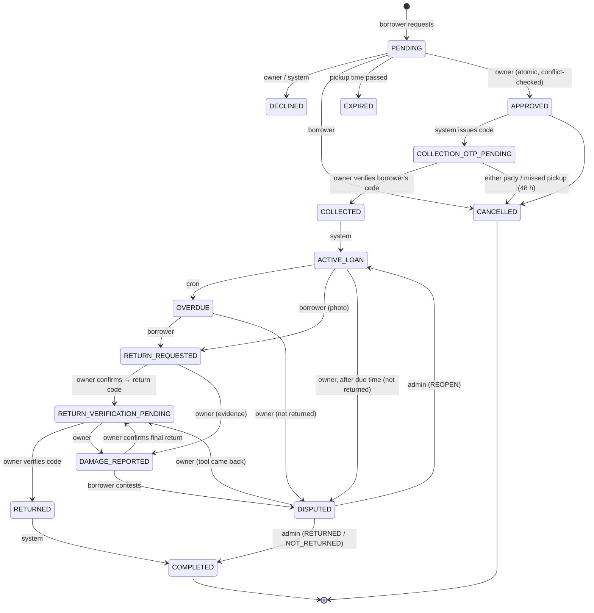

- The transition table, including which actor may perform each transition, lives in `convex/lib/stateMachine.ts`. It is enforced by `transitionLoan`, which also writes an audit event for every change. The loan page renders that audit trail as a timeline.
- Tool status is never written by clients. `recomputeToolStatus` derives it from the tool's loans, pending requests, listing toggle and owner state:
  - AVAILABLE / PENDING_REQUEST / RESERVED are discoverable.
  - LENT / RETURN_PENDING / UNAVAILABLE / REMOVED are not.
  - Multiple pending requests are allowed; only approved, non-terminal loans block a date range. Requests for non-overlapping dates remain possible while a tool is RESERVED.

## 8. Hand-over OTP security

- **Generation:** a 6-digit code from `crypto.getRandomValues` with rejection sampling (no modulo bias). It is generated in a Convex **action**, because queries and mutations are deterministic.
- **Storage:** only `HMAC-SHA256(OTP_PEPPER, "otp:v1:{loanId}:{purpose}:{code}")` is stored. The hash is bound to the loan and purpose, and offline brute force requires the server-side pepper.
- **Delivery:**
  - The code is emailed to the borrower (SMTP, or the dev mock mailbox).
  - The borrower can also reveal a fresh code in the app. The plaintext is returned once, only to the authenticated borrower, and invalidates earlier codes.
  - Codes **never** go through n8n, logs, audit metadata or notifications.
- **Verification:**
  - Only the **owner** can verify; the borrower reads the code aloud in person. Borrowers cannot verify their own hand-over.
  - Hash comparison is constant-time.
  - Expiry: collection codes are valid through the pickup window (capped at 7 days); on-demand codes last 15 minutes; return codes last 30 minutes.
  - After 5 wrong attempts the code is locked. Codes are single use (CONSUMED), and a new code supersedes old ones.
  - Per-user verification and per-loan issuance are rate-limited.
- **Transaction design:** a wrong guess *returns* rather than throws, so the attempt counter commits. A correct code consumes the OTP and applies the transition atomically.
- **Race handled:** a delayed scheduled system code never replaces a code the borrower has just requested on screen (regression test included).
- **Misconfiguration:** if `OTP_PEPPER` is missing, issuance fails closed with a clear `CONFIG` error. Production refuses to store codes in the mock mailbox.

## 9. Location privacy

- **Asking for location.**
  - On entry (landing page or map), the browser's permission prompt is shown at most **once per browser session**. If permission was already granted, the position is read silently.
  - Visitors who skip or close the prompt are not asked again automatically. Instead, every place a distance would appear (cards, map carousel, detail panel, header banner, locate button) offers **"Enable your location to see the actual distance"**, which asks again.
  - Browsers cannot re-prompt after "Block", so in that case the button opens step-by-step unblock instructions (Chrome/Edge/Brave, Firefox, Safari, Android, iPhone). A permission listener picks up the change automatically.
- **Live position, foreground only.** After permission, `watchPosition` follows the device while the page is **visible** and stops when the tab is hidden or closed. Jitter under 20 m is ignored. The map shows a pulsing **"Your location"** marker with an accuracy circle.
- **Distances** are computed on the device from the live position to each listing's approximate point ("350 m", "1.2 km"), and "Nearest" sorting uses them. Device coordinates are never stored or sent to the server; only a rounded search centre is sent (see below).
- The user's choice (GPS, manual place, or dismissed) is the only thing stored client-side. Users can disable device location entirely in their profile.
- **Public coordinates are approximate.**
  - The exact pickup point is snapped to a ~440 m grid cell, with a random in-cell offset. The result is always within about 600 m, and the grid is stable within a latitude band.
  - The server computes this; clients cannot set public coordinates.
- The discovery centre is rounded to about 110 m before it is sent, and distances are labelled `~`.
- **Exact pickup point and address** live in `toolPickupLocations`. They are returned only by `loans.get`, only to the borrower and owner of that loan, and only while it is live.
- The profile "approximate location" is coarsened to about 1 km on the server.
- **Photo uploads are re-encoded client-side** to strip EXIF/GPS metadata before upload.
- The landing page shows no owner identity, descriptions or exact data.

### Data-minimisation decisions (and where we deliberately show more)

| What | Shown to | Why |
| --- | --- | --- |
| **Public page:** tool name, category, availability **plus** photo, condition, neighbourhood name and a fuzzed (~500 m) map position | Anyone | The brief asks for "name and category only, no owner details". We keep **no owner details** and no descriptions/exact data, but show photo, condition and an approximate area because they decide whether a visitor signs up, and none of them identifies a person. Positions are snapped and jittered server-side (`approximateLocation`). Narrowing `tools.publicPreview` to name + category is a one-line change if a stricter reading is preferred. |
| **Borrower on an incoming request:** first name + last initial, avatar, verified history counts (borrowed, returned, late, damage confirmed) and published feedback | The tool's owner, before approving | The owner is lending a valuable item to a stranger; system-verified history is the trust signal that makes approving practical. No email, phone or location is shown, and the counts come from completed loans, not self-description. |
| **Exact pickup point and address** | Approved borrower of that loan (and the owner/admins) | Needed only to collect the tool; stored in a separate table and returned only by `loans.get` while the loan is live. |
| **n8n payloads** | n8n | Only what the message needs: recipient id, email and display name; event type; request/loan/tool ids, tool name and status; a short title/body; a deep link. No hand-over codes, pickup addresses, coordinates or tool descriptions. |
| **Automation activity on a loan** ("Lender notified · request approved · Email sent · 2 min ago") | That loan's owner, borrower and admins | Delivery facts only (type, status, time); no addresses, payloads or error text. `loans.automationActivity`. |
- Security headers include `Permissions-Policy: geolocation=(self)`.

## 10. n8n integration

Three workflows live in `n8n/workflows/`. They have fixed IDs and no embedded credentials. Full details are in [`n8n/README.md`](n8n/README.md).

**A – Request notification.** Convex writes an outbox row (`automationEvents`) in the same transaction as each request or loan status change, then a scheduled action POSTs a minimal signed payload to n8n. Workflow A then:
1. Verifies the HMAC and timestamp.
2. Validates the schema.
3. Claims the event ID through Convex (dedup).
4. Builds a minimal email.
5. Sends it through SMTP, or mocks it.
6. Reports the result back to Convex.
7. Responds to the webhook.

Status codes and behaviour:
- `401` for a bad signature, `400` for an invalid payload.
- `409` while another execution holds the claim. Convex then retries, so a slow SMTP send can never be mistaken for success.
- `502` after a send failure, so the Convex outbox retries.

**B – Daily overdue reminders.** Runs on a schedule at 09:00 UTC and can also be started manually.
1. Fetches the overdue candidates (signed request).
2. Claims each `(loan, day)` reminder idempotently.
3. Sends the reminder.
4. Reports per-reminder status.
5. Records a run summary (`automationRuns`).

**C – Error handler.** This is the error workflow for A and B. It records the workflow, execution ID, failed node, redacted error message, timestamp and related event ID in `automationFailures`, which the admin panel shows.

**What goes to n8n:** event ID and type, timestamp, recipient (user ID, email, display name), loan/request/tool IDs, tool name, status, title, body and app link. **Never** sent: OTPs, coordinates, addresses or secrets. Seed accounts are excluded.

## 11. Webhook security

Both directions use the same scheme:

```
x-lendloop-timestamp: <unix seconds>
x-lendloop-nonce:     <uuid>
x-lendloop-signature: sha256=HEX(HMAC_SHA256(secret, `${timestamp}.${nonce}.${rawBody}`))
```

- **Convex → n8n:** secret `N8N_WEBHOOK_SECRET`, plus an `x-lendloop-event-id` header.
- **n8n → Convex:** secret `AUTOMATION_INBOUND_SECRET`. The endpoints are `/automation/events/{claim,report}`, `/automation/overdue/candidates`, `/automation/reminders/{claim,report}`, `/automation/runs` and `/automation/errors`.
- **Checks on every request:**
  - ±300 s timestamp window.
  - Constant-time signature comparison.
  - **Nonce replay protection** (`webhookEvents`, `409` on replay).
  - 64 KB body limit.
  - **Strict** Zod schemas (unknown keys are rejected).
  - Generic error responses that never echo a reason or a secret.
- If a secret is not configured, the endpoint returns `503` and the app records outbound events as `SKIPPED` rather than pretending they were delivered.

## 12. Idempotency

| Concern | Mechanism |
| --- | --- |
| Duplicate webhook delivery | `eventId = evt_<convex id>` (unique by construction). n8n claims before sending; a delivered event returns `duplicate`. Leases expire after 5 minutes and are released on failure. |
| Duplicate reminders | `reminderKey = overdue:{loanId}:{UTC date}`. The claim is a single transaction; SENT/MOCKED is never resent that day. |
| Replayed requests | Nonce ledger |
| Duplicate requests/feedback | Pending-request and feedback uniqueness are checked inside the creating transaction (Convex mutations are serialisable) |
| Double approval / overlapping loans | Conflict check plus auto-decline of overlaps in the approving transaction. Concurrent approvals serialise on the same documents. |
| OTP reuse | CONSUMED status and state-machine guard |

## 13. Failure handling

- **Errors shown to users.** The backend throws `ConvexError({ code, message })` with user-safe text. Unexpected errors are redacted by Convex, and `toClientError` maps everything to friendly UI messages; raw internals are never shown.
- **States.** Every data view has loading, empty and error states. Forms show inline server errors. Toasts confirm actions.
- **Location.** Denied, unavailable or unsupported location falls back to manual place search or browsing everything.
- **Map providers.** If tiles fail, the map shows a banner and the list keeps working. Geocoding and routing failures degrade to a straight-line distance plus an "open in maps" link.
- **Uploads.** Image upload failures are reported per file. The server re-validates type and size.
- **Outbound automation.**
  - The outbox retries with exponential backoff and jitter: 30 s, 2 m, 10 m, 30 m, 2 h.
  - Exhausted events become `DEAD`, are recorded in `automationFailures`, and can be retried from the admin panel.
  - When n8n is not configured, events are recorded as `SKIPPED`, never silently dropped.
- **n8n side.** HTTP nodes retry 3×. Workflow failures reach Workflow C, which writes them to Convex.
- **Configuration.** If `NEXT_PUBLIC_CONVEX_URL` is missing, the app shows a configuration screen instead of crashing.
- **Time-based jobs.** Missed pickups (48 h), expired requests and overdue loans are handled by crons in bounded batches that re-schedule themselves.

## 14. Local development

> Step-by-step guides: **[Convex backend setup](docs/CONVEX_SETUP.md)** · **[n8n automation setup](docs/N8N_SETUP.md)**

Prerequisites: Node 20.9+ (tested on Node 24), npm, and Docker (for n8n).

```bash
npm install

# 1. Convex: creates a dev deployment and writes NEXT_PUBLIC_CONVEX_URL to .env.local.
#    You can use an account or run locally without one: CONVEX_AGENT_MODE=anonymous npx convex dev
npx convex dev            # keep running in its own terminal

# 2. Clerk: create an app at dashboard.clerk.com, or get temporary keys with
#    `npx clerk@latest init --accountless --framework next`.
#    Put the keys in .env.local (see .env.example).
#    In Clerk, add a JWT template named "convex" (Clerk dashboard → JWT templates → Convex preset),
#    or enable Clerk's Convex integration.

# 3. Backend env (fresh random secrets; nothing is printed)
sh scripts/setup-convex-env.sh https://<your-instance>.clerk.accounts.dev

# 4. Sample neighbourhood (Indiranagar, Bengaluru) — clearly marked "Sample"
npm run seed              # seed:run + scripts/seed-images.mjs (licensed demo photos)
# npm run seed:reset      # removes all seed data

# 5. App
npm run dev               # http://localhost:3000

# 6. (Optional) n8n — see section 16 and n8n/README.md
```

**Make yourself an admin.** Sign in once, then run:

```bash
npx convex run admin:setRoleByEmail '{"email":"you@example.com","role":"ADMIN"}'
```

**Testing hand-overs locally.**
- In `EMAIL_DELIVERY_MODE=mock`, emailed codes appear under *Account menu → Dev mailbox*.
- The borrower can also press *Show pickup code* on the loan page.
- Use two browsers (or a normal and a private window) for owner and borrower.

## 15. Environment variables

**Next.js (`.env.local`; template in `.env.example`)**

| Variable | Required | Purpose |
| --- | --- | --- |
| `NEXT_PUBLIC_CONVEX_URL`, `CONVEX_DEPLOYMENT` | yes | Written by `npx convex dev` |
| `NEXT_PUBLIC_CLERK_PUBLISHABLE_KEY`, `CLERK_SECRET_KEY` | yes | Clerk |
| `NEXT_PUBLIC_CLERK_SIGN_IN_URL` / `…SIGN_UP_URL` / fallback redirects | recommended | `/sign-in`, `/sign-up`, `/explore`, `/onboarding` |
| `NEXT_PUBLIC_MAPBOX_TOKEN` | recommended | Mapbox public token. Enables Mapbox GL with the Mapbox Standard style (faded theme, globe view). Without it the app uses MapLibre + OpenFreeMap. |
| `NEXT_PUBLIC_MAPBOX_STYLE_URL` | optional | Your own Mapbox Studio style instead of Standard |
| `NEXT_PUBLIC_MAP_STYLE_URL` | optional | Replace the built-in LendLoop basemap with any MapLibre style URL (MapTiler, CARTO, self-hosted) |
| `NEXT_PUBLIC_MAP_TILES_URL`, `NEXT_PUBLIC_MAP_GLYPHS_URL` | optional | Keep the LendLoop style but point it at another OpenMapTiles-schema tile source / glyph server (defaults: OpenFreeMap) |
| `GEOCODER_URL`, `GEOCODER_USER_AGENT` | optional / recommended | Nominatim proxy |
| `ROUTING_WALK_URL`, `ROUTING_DRIVE_URL` | optional | OSRM-compatible routers |

**Convex (`npx convex env set NAME value`)**

| Variable | Required | Purpose |
| --- | --- | --- |
| `CLERK_JWT_ISSUER_DOMAIN` | yes | Clerk issuer (`https://<instance>.clerk.accounts.dev` or your custom domain) |
| `OTP_PEPPER` | yes | ≥32 chars. HMAC key for OTP hashes. |
| `AUTOMATION_INBOUND_SECRET` | for n8n | Verifies n8n → Convex requests (must match n8n `LENDLOOP_AUTOMATION_SECRET`) |
| `N8N_WEBHOOK_URL`, `N8N_WEBHOOK_SECRET` | for n8n | Outbound webhook (must match n8n `LENDLOOP_N8N_WEBHOOK_SECRET`) |
| `APP_URL` | recommended | Absolute links in emails |
| `EMAIL_DELIVERY_MODE` | optional | `mock` (default) or `smtp` |
| `SMTP_HOST`, `SMTP_PORT`, `SMTP_SECURE`, `SMTP_USER`, `SMTP_PASS`, `EMAIL_FROM` | for smtp | Hand-over code emails |
| `DEPLOYMENT_ENV` | prod | Set to `production` to forbid mock storage of sensitive email |
| `SEED_ENABLED` | dev only | Enables `seed:run` / `seed:reset` |

**n8n (`n8n/.env`; template in `n8n/.env.example`):** `N8N_ENCRYPTION_KEY`, `LENDLOOP_N8N_WEBHOOK_SECRET`, `LENDLOOP_AUTOMATION_SECRET`, `LENDLOOP_CONVEX_SITE_URL`, `LENDLOOP_EMAIL_MODE`, `LENDLOOP_EMAIL_FROM`.

## 16. Docker Compose (n8n)

```bash
cp n8n/.env.example n8n/.env                          # fill in the three secrets
npx convex env set N8N_WEBHOOK_URL http://127.0.0.1:5678/webhook/lendloop-events
npx convex env set N8N_WEBHOOK_SECRET <same as LENDLOOP_N8N_WEBHOOK_SECRET>
docker compose up -d                                  # n8n on http://127.0.0.1:5678
sh n8n/scripts/import-workflows.sh                    # import + publish A, B, C (restarts n8n once)
node n8n/scripts/send-test-event.mjs --test           # signed test event (+ --bad-signature, --stale, …)
```

- n8n binds to loopback only, reaches the local Convex backend through `host.docker.internal`, and prunes execution data after 7 days.
- For real email: create an SMTP credential named **"LendLoop SMTP"** in the n8n UI, set `LENDLOOP_EMAIL_MODE=smtp`, then re-run the import script.

## 17. Testing

```bash
npm test                    # unit + Convex integration (Vitest)
npm run test:unit
npm run test:integration
npm run typecheck           # Next app + Convex project
npm run lint
npm run build
PLAYWRIGHT_CHROME_PATH=/usr/bin/google-chrome npm run test:e2e   # needs Clerk keys + running Convex
CAPTURE_SCREENSHOTS=1 npx playwright test tests/e2e/screenshots.spec.ts   # regenerate docs/screenshots
```

**Unit tests (78)**
- Distance, formatting, bounding boxes, location fuzzing.
- State machine transitions and actor rules, tool status derivation.
- Borrow-window validation and overlap detection.
- Reputation (verified vs unverified), feedback eligibility and tags.
- OTP generation, uniformity and hashing.
- HMAC signing and verification: RFC 4231 vector, tampering, stale timestamps.
- Retry backoff, reminder keys, log and audit redaction.

**Convex integration tests (50; `convex-test` runs the real functions, scheduler and HTTP actions)**
- *Full lifecycle* (`lifecycle.test.ts`): 14 checkpoints through feedback and the audit trail; decline; cancel before pickup; overdue and late-return accounting.
- *Requests:* own tool, past or reversed dates, too long, duplicate pending, multiple borrowers with auto-decline of overlaps, an approval race, unlisting, expiry, withdrawal, deleting a tool that has a loan.
- *OTP:* the borrower cannot verify, the owner never sees codes, attempt counting and lockout, expiry, supersession, issuance rate limit, format validation, missing pepper fails closed, and the scheduled-vs-on-demand race.
- *Authorisation:* anonymous access, no role escalation, admin-only functions, suspension, listing IDOR, another user's upload, loan IDOR, role-specific actions, feedback restrictions, reporting.
- *Disputes:* damage reported → acknowledged and then completed; contested → admin dismissal → completed; not returned → admin confirms loss; tool turns up later.
- *Privacy:* the public preview field allow-list, no exact coordinates in discovery or details, pickup reveal only to the approved borrower, profile coarsening.
- *Automation:* SKIPPED when unconfigured; signed minimal payload; retries → DEAD → admin retry; OTP never forwarded; bad signature, stale timestamp, replay and strict schema; event dedup and leases; sanitised error records; reminder idempotency per day.

**End-to-end (Playwright + Clerk testing tokens, real Clerk + Convex + Next)**
- `lifecycle.spec.ts` covers the whole assessment flow:
  1. Two users sign in; the first visit goes through onboarding.
  2. The owner lists a tool with a photo and a map pin.
  3. The borrower finds it on the map (marker highlighted) and requests it.
  4. The owner is notified live and approves after reviewing the borrower's reputation.
  5. The borrower sees the exact pickup point and reveals the code; a wrong code is rejected and the right one is verified.
  6. The loan becomes active; the borrower starts the return with a photo; the owner is notified and confirms.
  7. The return code is verified and the loan completes.
  8. Both leave feedback.
  9. The borrower is blocked from `/admin` and a stranger is redirected away from the loan.
  10. The listing is deleted to clean up.
- `public.spec.ts` checks that the landing page is free of private data and that signed-out visitors are redirected.
- Run the same suite against a deployed site with `E2E_BASE_URL=https://lendloopapp.vercel.app npm run test:e2e` (no local server is started). It creates the two `+clerk_test` members and a temporary listing in that deployment, and deletes the listing at the end.
- The "sign up" step creates users through Clerk's Backend API and then signs in with a ticket; it does not drive the Clerk sign-up form.

## 18. Deployment

**Step-by-step free deployment (Vercel + Convex + Render/Oracle for n8n), including the SMTP-port question: [`docs/DEPLOY.md`](docs/DEPLOY.md).** For Render-style hosts, `n8n/Dockerfile` bakes in the workflows and imports + publishes them on every start.

1. **Convex:**
   - Run `npx convex deploy` (set `CONVEX_DEPLOY_KEY` in CI).
   - Set the production env vars with `npx convex env set --prod …`.
   - Never set `SEED_ENABLED`. Set `DEPLOYMENT_ENV=production` and `EMAIL_DELIVERY_MODE=smtp`.
2. **Clerk:**
   - Create a production instance with a custom domain, and create the `convex` JWT template there.
   - Set `CLERK_JWT_ISSUER_DOMAIN` to the production Frontend API URL.
3. **Next.js (e.g. Vercel):**
   - Set the variables from section 15.
   - Build command: `npx convex deploy --cmd 'npm run build'`. This builds against the deployed Convex URL.
4. **n8n:**
   - Run n8n self-hosted or on n8n Cloud, behind HTTPS.
   - Set `LENDLOOP_CONVEX_SITE_URL=https://<deployment>.convex.site` and `N8N_WEBHOOK_URL` to the public webhook URL.
   - Create the SMTP credential, import the workflows and publish them.
5. **Admin:** promote the first administrator with `npx convex run --prod admin:setRoleByEmail …`.

## 19. Production readiness

**Implemented**
- Backend RBAC and IDOR protection.
- The state machine and its audit trail.
- Hashed, rate-limited, single-use OTPs.
- Signed and replay-protected webhooks with idempotency and an outbox with dead-lettering.
- Location fuzzing and EXIF stripping.
- Security headers: CSP, HSTS in production, `frame-ancestors 'none'`, `nosniff`, Referrer-Policy and Permissions-Policy.
- Rate limits, input validation on both sides, redacted logs, and housekeeping crons for nonces, rate-limit windows, orphaned uploads and the mock mailbox.

**Recommended before going live (not implemented)**
- **Email:**
  - Use a transactional provider (Postmark, SES, Resend) on our own domain with SPF/DKIM/DMARC, bounce handling and per-user notification preferences (the demo sends through Gmail SMTP with an app password).
  - Consider SMS or push for hand-over codes.
- **Maps:**
  - OpenFreeMap is free and keyless but has no SLA. For production, self-host the tiles (Planetiler + PMTiles) or use a provider with an SLA (MapTiler, Stadia, Protomaps).
  - The public Nominatim and OSRM servers are for development only; use paid or self-hosted geocoding and routing.
- **Images:**
  - Strip metadata and scan for malware on the server as well.
  - Generate thumbnails, use signed or short-lived URLs (Convex storage URLs are unguessable but public), and moderate content.
- **Rate limiting:** add edge/WAF limits. Replace the in-memory Next proxy limiter with a shared store (Redis/Upstash) or the Convex rate-limiter component.
- **Monitoring and logging:** error tracking (Sentry), Convex log streams to a log platform, alerts on DEAD automation events and on failure spikes, uptime checks for n8n.
- **Backups:** Convex scheduled snapshot exports and n8n database backups, with documented restore drills.
- **Abuse prevention:**
  - Clerk bot protection and email verification.
  - Optional phone or ID verification for higher-value tools.
  - Velocity limits on new accounts, report thresholds that trigger review, and duplicate-account detection.
- **Disputes:** a structured evidence timeline, deadlines, two-sided messaging, admin SLAs, and possibly deposits or insurance through a payments provider (deposits are informational today).
- **Legal:**
  - Privacy policy and terms of use, plus cookie consent if analytics are added.
  - A data retention schedule: purge audit metadata, photos and dispute evidence after N months.
  - Data subject requests for export and deletion. Clerk user-deletion webhooks should cascade to the Convex profile.
- **Regulation:** GDPR/DPDP (India) obligations for location and personal data; consumer protection and liability for peer lending; insurance, and age limits for dangerous tools.

## 20. Known limitations

- Seed listings use openly licensed demo photos (CC0 / Public Domain / CC BY) from `seed-assets/`, with attribution shown on each photo and listed in `seed-assets/CREDITS.md`. The one tool without a suitable licensed photo (the manual tile cutter) falls back to a category glyph. Seed accounts cannot sign in or receive email, and are labelled *Sample*.
- In local development the Clerk keys may be temporary "accountless" keys from `clerk init`. Claim the app (`clerk auth login`) or replace the keys before sharing the setup.
- n8n Workflow B's send path was verified with empty and synthetic candidate lists. The reminder claim/report idempotency is covered by Convex integration tests. A real overdue loan was not driven through n8n end-to-end.
- Dates and times are entered and shown in the viewer's local time zone. Neighbours are assumed to share one.
- The Next.js map-proxy rate limiter is per-instance memory.
- There is no in-app messaging between members; coordination happens through request messages and the return-arrangement note.
