# LendLoop architecture reference

This is a code-accurate reference for engineers and reviewers. It explains what happens on every call. Each statement was checked against the source in this repository: the Convex backend in `convex/`, the Next.js app in `src/` and the n8n workflows in `n8n/workflows/`. Where the code does not settle a question, the text says so.

Setup and deployment steps are in `README.md`, `docs/CONVEX_SETUP.md`, `docs/N8N_SETUP.md` and `docs/DEPLOY.md`.

**Conventions**
- `module.fn` names a Convex function exported from `convex/module.ts`. For example, `requests.approve` is `api.requests.approve`.
- "Viewer" means the caller's row in the Convex `users` table.
- Times are in epoch milliseconds, except HMAC timestamps, which are Unix seconds.
- Environment variables appear by **name only**. This document contains no values.

## Contents

1. [System context](#1-system-context)
2. [Request lifecycle basics](#2-request-lifecycle-basics)
3. [Operations](#3-operations)
   - 3.1 [Sign-up, sign-in, user sync, onboarding](#31-sign-up-sign-in-user-sync-and-onboarding)
   - 3.2 [Discovery](#32-discovery-toolsdiscover)
   - 3.3 [Public landing preview](#33-public-landing-preview-toolspublicpreview)
   - 3.4 [Geocoding and routing API routes](#34-geocoding-and-routing-api-routes)
   - 3.5 [Create, edit, pause and delete a listing](#35-create-edit-pause-and-delete-a-listing)
   - 3.6 [Create a borrow request](#36-create-a-borrow-request)
   - 3.7 [Approve, decline, cancel, expire](#37-approve-decline-cancel-expire)
   - 3.8 [Loan state machine](#38-loan-state-machine)
   - 3.9 [Pickup OTP: issue and verify](#39-pickup-otp-issue-and-verify)
   - 3.10 [Return and return OTP](#310-return-and-return-otp)
   - 3.11 [Damage reports and disputes](#311-damage-reports-and-disputes)
   - 3.12 [Feedback, reports, trust and reputation](#312-feedback-reports-trust-and-reputation)
   - 3.13 [In-app notifications](#313-in-app-notifications)
   - 3.14 [n8n Workflow A: outbox → signed webhook → claim/report](#314-n8n-workflow-a-outbox--signed-webhook--claimreport)
   - 3.15 [n8n Workflow B: daily overdue reminders](#315-n8n-workflow-b-daily-overdue-reminders)
   - 3.16 [n8n Workflow C: error handler](#316-n8n-workflow-c-error-handler)
   - 3.17 [Convex crons and scheduled jobs](#317-convex-crons-and-scheduled-jobs)
   - 3.18 [Admin operations](#318-admin-operations)
   - 3.19 [Seed data](#319-seed-data)
4. [Data model](#4-data-model)
5. [Function and route catalogue](#5-function-and-route-catalogue)
6. [Security and privacy](#6-security-and-privacy)
7. [Environments and configuration](#7-environments-and-configuration)
8. [CI/CD](#8-cicd)
9. [Notes for reviewers](#9-notes-for-reviewers)

---

## 1. System context

| Component | Runs on | Talks to | Transport and auth |
| --- | --- | --- | --- |
| Browser app (React 19, Convex React client, Clerk JS, map engine) | User device | Vercel, Convex, Clerk, tile hosts, Convex storage | HTTPS; WSS to Convex with a Clerk JWT |
| Next.js 16 App Router (`src/`) | Vercel | Clerk (session), Nominatim, OSRM | HTTPS; Clerk session cookie |
| Convex deployment (`convex/`) | Convex cloud. Client API and WebSocket on `*.convex.cloud`; HTTP actions on `*.convex.site` | Clerk (JWT verification), SMTP (Resend), n8n | WSS + JWT; SMTP; HMAC-signed HTTP |
| Clerk | Clerk | Browser; Convex validates its JWTs | JWT template `convex` (or Clerk's native Convex integration) |
| n8n 2.46.6 (`n8n/Dockerfile`) | Render (Docker) | Convex HTTP actions; SMTP only when `LENDLOOP_EMAIL_MODE=smtp` | HMAC-signed HTTP in both directions |
| Resend | Resend | — | SMTP from Convex (`convex/emailNode.ts`) and optionally from n8n |
| Nominatim and OSRM | Public servers by default | — | HTTPS, called only from Next API routes |
| Basemap | Mapbox (when `NEXT_PUBLIC_MAPBOX_TOKEN` is set) or OpenFreeMap | — | HTTPS from the browser |

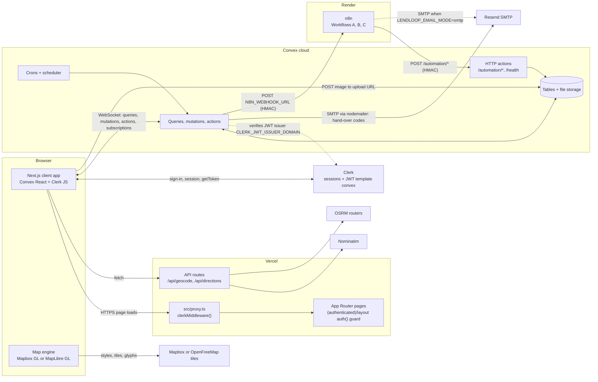

Key facts:
- **Two email paths.**
  - Hand-over codes go Convex → SMTP directly: `otpActions` → `email.send` → `emailNode.sendSmtp`. They never pass through n8n.
  - Notification emails go Convex outbox → n8n → SMTP.
  - The Next.js app sends no email.
- **The browser never calls Nominatim or OSRM.** The CSP `connect-src` in `next.config.ts` does not list them.
- **Map engine choice is fixed at build time.** `loadMapEngine()` in `src/components/map/mapEngine.ts` imports `mapbox-gl` when `NEXT_PUBLIC_MAPBOX_TOKEN` is set, and `maplibre-gl` otherwise. There is no runtime failover. The MapLibre worker is served from `/vendor/maplibre-gl-worker-<version>.mjs`, which `scripts/copy-maplibre-worker.mjs` copies there on install, dev and build.
- **n8n on Render Free cannot send email.** Render Free blocks outbound SMTP ports (see `docs/DEPLOY.md`), so n8n is expected to run with `LENDLOOP_EMAIL_MODE=mock` there. Deliveries are still recorded as `MOCKED`.

---

## 2. Request lifecycle basics

### 2.1 Page load

1. **`src/proxy.ts`** runs `clerkMiddleware()`. In Next 16 the `middleware` file convention was renamed `proxy`.
   - It runs for every path except `_next` internals and static assets, and always for `/(api|trpc)(.*)`.
   - It blocks nothing. It only makes the Clerk session available to `auth()`.
2. **`src/app/layout.tsx`** wraps everything in `<ClerkProvider>` with these props:

   | Prop | Value |
   | --- | --- |
   | `signInUrl` | `/sign-in` |
   | `signUpUrl` | `/sign-up` |
   | `signInFallbackRedirectUrl` | `/explore` |
   | `signUpFallbackRedirectUrl` | `/onboarding` |

   It also loads the MapLibre and Mapbox CSS and the fonts.
3. **`src/app/providers.tsx`** (client) sets up the providers.
   - It creates one module-level `ConvexReactClient(NEXT_PUBLIC_CONVEX_URL)`. If the variable is missing, it renders `ConfigError` instead.
   - Otherwise it renders `ConvexProviderWithClerk(useAuth)` → `QueryClientProvider` → `ToastProvider`.
   - TanStack Query is used only for `/api/geocode` and `/api/directions`, with `retry: 1`, `staleTime: 5 min` and no refetch on focus.
4. **Public routes** render directly: `/`, `/sign-in/[[...sign-in]]` and `/sign-up/[[...sign-up]]`.
5. **`src/app/(authenticated)/layout.tsx`** is a server component that runs `const { userId } = await auth(); if (!userId) redirect("/sign-in")`. It then renders `AuthenticatedShell`, which renders `AuthGate`. `/onboarding` renders without `AppShell`.
6. **`AuthGate`** (`src/features/authentication/AuthGate.tsx`) walks through the states in the diagram below. When all checks pass, it provides `ViewerContext` (the `users.me` result) and `LocationProvider sharingEnabled={me.locationSharing}`.

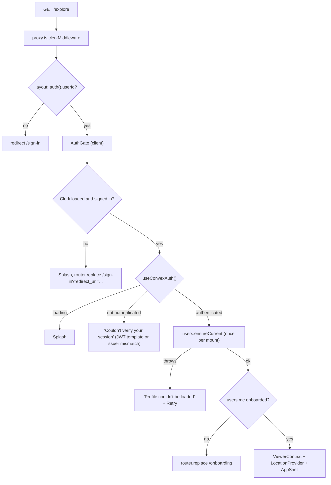

### 2.2 How a Convex call is authenticated

1. **Getting a token.** `ConvexProviderWithClerk` (`convex/react-clerk`) calls Clerk's `getToken()`.
   - If the session token's `aud` is already `convex` (Clerk's native integration), it uses that token.
   - Otherwise it calls `getToken({ template: "convex" })`.
   - The token is sent on the WebSocket and refreshed by the client.
2. **Validating the token.** `convex/auth.config.ts` declares a single provider: `{ domain: process.env.CLERK_JWT_ISSUER_DOMAIN, applicationID: "convex" }`. Convex accepts only JWTs from that issuer whose audience is `convex`.
3. **Resolving the user.** `ctx.auth.getUserIdentity()` returns the claims and a `tokenIdentifier`, which Convex derives from issuer + subject. The helpers in `convex/lib/auth.ts` map that identity to a `users` row through the `by_token` index:

| Helper | Behaviour |
| --- | --- |
| `getViewer` | Returns the `users` row, or `null` when signed out or not yet synced |
| `requireViewer` | Throws `UNAUTHENTICATED` without an identity, or `PROFILE_MISSING` when there is no row |
| `requireActiveViewer` | `requireViewer`, plus `ACCOUNT_SUSPENDED` unless `status === "ACTIVE"` (required for almost every write) |
| `requireAdmin` | `requireActiveViewer`, plus `FORBIDDEN` unless `role === "ADMIN"` |
| `loanRoleOf(user, loan, allowAdmin = true)` | Returns `BORROWER` / `OWNER` / `ADMIN`, or throws `NOT_FOUND` (prevents IDOR) |

- **Actions.** `otpActions.requestCode` and `otpActions.verifyCode` read the identity and pass `identity.tokenIdentifier` into internal mutations. Those mutations re-resolve the user and re-check status and role.
- **HTTP actions** (`convex/http.ts`) do not use Clerk. They authenticate with HMAC (see §3.14).
- **`/api/directions`** checks the Clerk session with `auth()` from `@clerk/nextjs/server`, independently of Convex.
- **Convex is the security boundary.** The proxy, the layout guard and `AuthGate` are UX layers.
- **A user row belongs to one Clerk instance.** Because `tokenIdentifier` includes the issuer, switching Clerk instances (for example dev → prod) creates new `users` rows on first sign-in.

### 2.3 Error model

**Server side**
- `appError(code, message, extra)` in `convex/lib/errors.ts` throws `ConvexError<{ code, message, ...extra }>`.
- The codes are: `UNAUTHENTICATED`, `PROFILE_MISSING`, `ACCOUNT_SUSPENDED`, `FORBIDDEN`, `NOT_FOUND`, `INVALID_INPUT`, `INVALID_STATE`, `CONFLICT`, `DUPLICATE`, `UNAVAILABLE`, `RATE_LIMITED`, `OTP_INVALID`, `OTP_EXPIRED`, `OTP_LOCKED`, `OTP_MISSING` and `CONFIG`.
- Extra fields in use:

  | Field | Sent with |
  | --- | --- |
  | `retryAfterSec` | `RATE_LIMITED` |
  | `attemptsRemaining` | `OTP_*` |
  | `reason` | Borrow-window failures, e.g. `START_IN_PAST`, `TOO_LONG`, `OUTSIDE_AVAILABILITY` |
  | `status` | `INVALID_STATE` from `transitionLoan` |

- State-machine violations (`TransitionError`) are converted to `INVALID_STATE` with a user-safe message.
- Plain `Error` throws reach the client as a redacted generic server error. Examples: `email.send` refusing mock mode in production, the seed guards, and Convex argument-validator failures.
- **A mutation that throws rolls back every write**, including notifications, outbox rows and scheduled jobs. The one deliberate exception is a wrong OTP guess: it *returns* a failure so that the attempt counter commits (§3.9).
- Some queries return `null` or `[]` instead of throwing, so they don't confirm that a resource exists: `loans.get` for non-participants, `tools.getForEdit` for non-owners, and `tools.get` for removed tools when the viewer is neither owner nor admin.

**Client side**
- `toClientError` in `src/lib/errors.ts` normalises any thrown value:

  | Thrown value | Result |
  | --- | --- |
  | `ConvexError` | Its `code` and `message` (with per-code fallbacks) |
  | Anything while offline, or a fetch `TypeError` | `NETWORK` |
  | Anything else | `UNKNOWN`, with a generic message |

- Only `RATE_LIMITED`, `NETWORK` and `UNKNOWN` are marked `retryable`.
- Forms show the message inline; actions show toasts.
- `src/app/error.tsx` is the route error boundary, and `src/app/not-found.tsx` handles 404s.
- Map proxy failures surface as `MapServiceError` (`src/services/maps.ts`) with 429, 404 and generic messages.

### 2.4 Rate limiting

`enforceRateLimit(ctx, key, rule)` in `convex/lib/rateLimit.ts` is a fixed-window counter.
- Each counter is a `rateLimits` row looked up by `by_key`.
- The window resets when `now - windowStart >= windowMs`.
- It throws `RATE_LIMITED` with `retryAfterSec`.
- Concurrent calls serialise on the counter document (Convex OCC).
- The daily housekeeping job deletes rows whose `windowStart` is older than 24 h, up to 500 per run.

| Rule | Key | Limit / window | Enforced in |
| --- | --- | --- | --- |
| `createRequest` | `request:create:{userId}` | 20 / 1 h | `requests.create` |
| `createTool` | `tool:create:{userId}` | 20 / 1 h | `tools.create` |
| `uploadUrl` | `upload:{userId}` | 60 / 1 h | `files.generateUploadUrl` |
| `otpIssue` | `otp:issue:{loanId}:{purpose}` | 6 / 1 h | `otp.storeCode` (on-demand codes only) |
| `otpVerify` | `otp:verify:{userId}` | 15 / 15 min | `otp.consumeCode` |
| `feedback` | `feedback:{userId}` | 30 / 1 h | `feedback.submit` |
| `report` | `report:{userId}` | 10 / 1 h | `feedback.report` |
| `profileUpdate` | `profile:{userId}` | 30 / 1 h | `users.updateProfile` |
| Next proxy | `geo:{client IP}` | 30 / 60 s | `/api/geocode` (in-memory, per instance) |
| Next proxy | `route:{Clerk userId}` | 20 / 60 s | `/api/directions` (in-memory, per instance) |

The Next limiter is `allow()` in `src/services/serverRateLimit.ts`. It is a process-local `Map` that is cleared once it holds more than 5000 keys.

### 2.5 Audit log

`writeAudit` in `convex/lib/audit.ts` inserts an `auditLogs` row with these fields: `actorId?`, `actorType` (`USER`/`ADMIN`/`SYSTEM`/`AUTOMATION`), `action`, `resourceType`, `resourceId`, `fromStatus?`, `toStatus?`, `meta?` and `createdAt`.

- **Metadata sanitising.** `sanitizeAuditMeta` drops any metadata key whose camelCase or snake_case segments include `otp`, `code`, `token`, `secret`, `password`, `lat`, `lng`, `latitude`, `longitude`, `address`, `email` or `phone`. It also truncates string values to 300 characters.
- **Loan changes are always audited.** Every loan status change goes through `transitionLoan` (`convex/lib/loans.ts`), which asserts the transition and writes `loan.status_changed`.
- **Loan timeline.** `loans.get` returns the loan's audit rows (`by_resource`, ascending, at most 100) as `timeline`, with actors mapped to `BORROWER`, `OWNER` or the actor type.
- **Admin view.** `admin.auditLogs` lists recent rows, optionally filtered by `resourceType`.

Actions written by the code:

| Area | Actions |
| --- | --- |
| Users | `user.created`, `user.onboarded`, `user.profile_updated` |
| Tools | `tool.created`, `tool.updated`, `tool.listed`, `tool.unlisted`, `tool.removed` |
| Requests | `request.created`, `request.approved`, `request.declined`, `request.cancelled`, `request.expired` |
| Loans | `loan.created`, `loan.status_changed`, `loan.return_arrangement_updated` |
| OTP | `otp.issued`, `otp.failed_attempt`, `otp.locked`, `otp.verified` |
| Damage | `damage.reported`, `damage.acknowledged`, `damage.contested` |
| Feedback | `feedback.submitted`, `feedback.reported` |
| Automation | `automation.dead_lettered`, `automation.delivery_reported` |
| Admin | `admin.trusted_granted`, `admin.trusted_revoked`, `admin.user_suspended`, `admin.user_reinstated`, `admin.tool_removed`, `admin.tool_restored`, `admin.damage_reviewed`, `admin.report_dismissed`, `admin.feedback_hidden`, `admin.automation_retry`, `admin.automation_failure_resolved`, `admin.role_changed` |

### 2.6 Realtime and background execution

- **Realtime.** Every `useQuery` is a subscription. When a mutation commits, Convex re-runs the affected queries and pushes the new results over the same WebSocket. There is no polling and no second realtime channel.
- **Scheduled work.** `ctx.scheduler.runAfter` enqueues work that runs only if the calling mutation commits. The code schedules:
  - `automation.deliverEvent` for each outbox row, and again for backoff retries;
  - `otpActions.issueSystemCode` after `requests.approve` and `loans.confirmReturnReady`;
  - self-rescheduling cron batches.
- **Actions** handle the non-deterministic work:
  - secure randomness (OTPs);
  - outbound HTTP (the n8n webhook);
  - SMTP, which runs in the `"use node"` runtime because nodemailer needs Node.

---

## 3. Operations

Every subsection follows the same pattern: a diagram, then numbered steps naming the exact functions, tables and indexes involved, then what the client sees.

### 3.1 Sign-up, sign-in, user sync and onboarding

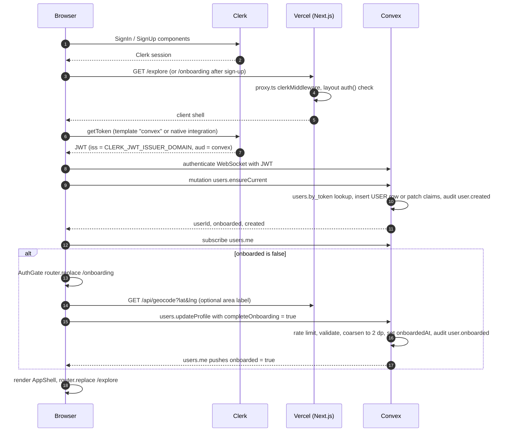

1. **Clerk pages.** `/sign-in/[[...sign-in]]` renders `<SignIn withSignUp />` and `/sign-up/[[...sign-up]]` renders `<SignUp />`, both inside `AuthFrame`. Clerk handles credentials, OAuth, verification and bot protection. The CSP allows `challenges.cloudflare.com` and `*.protect.clerk.com`.
2. **Route guards.** The server guard and `AuthGate` run as described in §2.1.
3. **`users.ensureCurrent`** (mutation; needs an identity; not rate limited) looks up `users.by_token`.
   - **Existing row:** patches `email` and `imageUrl` when the claim is non-empty and differs. It also patches `phoneVerified` and `phoneNumber`; the number is stored only when `phoneNumberVerified === true`. `name` is **not** overwritten, because the user edits it.
   - **New row:** inserts these fields, then writes the audit entry `user.created`:

     | Field | Value |
     | --- | --- |
     | `tokenIdentifier` | From the identity |
     | `clerkUserId` | `identity.subject` |
     | `email` | The email claim, or `""` |
     | `name` | The name claim, else given + family name, else the email local part, else `"Neighbour"` |
     | `locationSharing` | `true` |
     | `role` | `"USER"` |
     | `status` | `"ACTIVE"` |
     | `trustedLender` | `false` |
     | `stats` | `EMPTY_STATS` |

   - Returns `{ userId, onboarded, created }`.
4. **`users.me`** (query, `getViewer`) returns the viewer's own profile, including private fields: email, phone, coarse location, role, status, stats and computed reputation. It returns `null` when signed out.
5. **Onboarding form.** `/onboarding` renders `ProfileForm onboarding`.
   - "Use current area" reads geolocation once and rounds it client-side to 2 decimals.
   - It then calls `/api/geocode` in reverse mode to suggest an area label.
6. **`users.updateProfile`** uses `requireViewer`, so suspended users can still edit their profile.
   - **Rate limit:** `profile:{userId}`.
   - **Validation:** name 2–60 characters, bio ≤ 280, area ≤ 80.
   - **Location:** `approxLocation: null` clears it. An object is checked with `isValidLatLng` and stored as `coarsen(p, 2)` (≈ 1.1 km).
   - **Onboarding:** `onboardedAt` is set only the first time `completeOnboarding` is passed.
   - **Audit:** `user.onboarded` or `user.profile_updated`.
7. **Client.** `users.me` re-emits; `AuthGate` renders the app; `ProfileForm.onDone` navigates to `/explore`.

New users always get `role: "USER"`. The only way to `ADMIN` is the internal mutation `admin.setRoleByEmail` (§3.18).

### 3.2 Discovery (`tools.discover`)

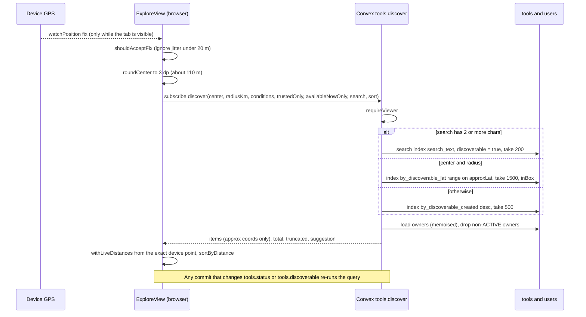

**Client side** (`src/features/discovery/LocationProvider.tsx`, `ExploreView.tsx`, `src/lib/location.ts`)

1. **Resolving a location.** `LocationProvider` tries, in order:
   - a stored manual place;
   - `disabled` when the profile's `locationSharing` is false;
   - the Permissions API (silent read when permission is already granted);
   - otherwise, at most one automatic prompt per browser session (`sessionStorage` key `lendloop.location.asked`).

   After a fix, `watchPosition` runs only while the tab is visible. `shouldAcceptFix` takes a new fix only when it moved ≥ 20 m, is much more accurate, or the old fix is ≥ 60 s old. `localStorage` (`lendloop.location.v1`) stores only the choice and an optional manual place.
2. **Building the query.** `ExploreView` builds the arguments as follows:

   | Argument | How it is built |
   | --- | --- |
   | `center` | `roundCenter(point)`: 3 decimals, ≈ 110 m |
   | `radiusKm` | Sent only when there is a point and the filter is not `"ANY"`. Default 10; options 1, 2, 5, 10, 25, 50, ANY |
   | `sort` | Falls back to `recent` when there is no point |
   | `search` | URL `q`, only when it has ≥ 2 characters |

   **Category is not sent.** The category and "available only" chips filter on the client so that every chip can show a live count.
3. **Subscription.** `useQuery(api.tools.discover, args)`.

**Server side** (`convex/tools.ts`)

1. **Auth:** `requireViewer`. The viewer must be signed in and synced, but need not be `ACTIVE`.
2. **Clamping:**
   - `limit`: clamp(`args.limit ?? 150`, 1, 300);
   - `center`: used only if `isValidLatLng`;
   - `radiusKm`: clamp(0.5, 50), where 50 is `MAX_DISCOVERY_RADIUS_KM`;
   - `search`: trimmed and cut to 80 characters.
3. **Candidate set.** Exactly one of three paths, as in the diagram:
   - search index with filter fields `discoverable` (+ `category` if passed);
   - latitude range scan over `boundingBox(center, radiusKm)`, then an antimeridian-aware `inBox` longitude check;
   - newest-first scan.
4. **Per-row filters:**
   - `category`;
   - `conditions`;
   - `availableNowOnly` drops `RESERVED`;
   - haversine distance > radius is dropped (this also applies to search results when a center and radius are given);
   - the owner must exist and be `ACTIVE`;
   - `trustedOnly` requires `owner.trustedLender`.
5. **Sort:**
   - `nearest` is the default with a center and uses the server distance from the rounded center;
   - `rating` sorts by the owner's average rating, then newest;
   - `recent` sorts by `createdAt` descending.
6. **Projection.** Each item is a `toolCard` plus extra fields:
   - `toolCard`: id, name, category, condition, status, pickupArea, `approxLat`/`approxLng`, the first image URL from `ctx.storage.getUrl`, createdAt and isSeed;
   - extras: `distanceKm`, `isMine`, `excerpt` (≤ 160 chars), `maxLoanDays` and `depositAmount`;
   - `owner`: `userSummary` (display name "First L.", avatar, trustedLender, averageRating, reviewCount, memberSince, isSeed) plus `areaLabel`.
7. **Result:** `{ items, total, truncated, suggestion }`. When nothing matches near a center, `suggestion` holds the newest discoverable tool's approximate point and `pickupArea`.

**Client post-processing and realtime**
- `withLiveDistances` replaces `distanceKm` with `haversineKm(exactDevicePoint, tool.approx*)`. `sortByDistance` applies for `nearest`, and `formatDistance` renders labels such as "350 m" or "1.2 km".
- Selecting a tool subscribes to `tools.get`. It returns full details and never the exact location: `bookedRanges` of blocking loans, owner reputation, and `viewer.canRequest/pendingRequestId/activeLoanId`.
- Pins appear, disappear or change availability as soon as any mutation commits a change to `tools.status` or `tools.discoverable`.

### 3.3 Public landing preview (`tools.publicPreview`)

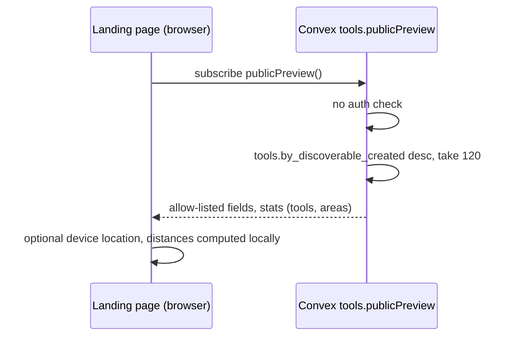

1. **Page.** `/` renders `Landing` (`src/components/landing/Landing.tsx`) inside its own `LocationProvider`.
   - Visitors get `sharingEnabled: true`.
   - Signed-in members use their `users.me.locationSharing` setting.
2. **`tools.publicPreview`** needs no auth. It returns only these fields: `id`, `name`, `category`, `condition`, `pickupArea`, `approxLat`, `approxLng`, the first `imageUrl`, `availableNow` (`status !== "RESERVED"`) and `isSeed`.
3. **Stats.** `stats.areas` counts the distinct first comma-separated segment of `pickupArea`.
4. **Privacy.** The response contains no owner identity, description or exact data. `tests/integration/privacy.test.ts` asserts this allow-list.
5. **Suspended owners.** Their tools are already non-discoverable, because `admin.setStatus` recomputes their tool statuses, so they never appear here.

### 3.4 Geocoding and routing API routes

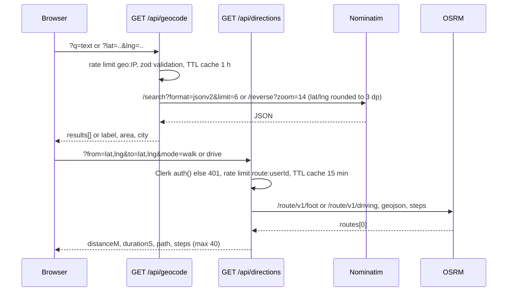

| | `/api/geocode` (`src/app/api/geocode/route.ts`) | `/api/directions` (`src/app/api/directions/route.ts`) |
| --- | --- | --- |
| Method | `GET` | `GET` |
| Auth | None. The public landing page uses it for place search | Clerk `auth()` → `401 {"error":"unauthenticated"}` |
| Rate limit | 30 / min per first `x-forwarded-for` IP (or `x-real-ip`, else `"local"`) → `429` | 20 / min per Clerk `userId` → `429` |
| Input | `q`: 2–120 chars; or `lat` −90..90 and `lng` −180..180 (coerced) → `400 invalid_query` | `from` and `to` as `lat,lng`; `mode` `walk` (default) or `drive` → `400 invalid_query` |
| Upstream | `GEOCODER_URL` (default `https://nominatim.openstreetmap.org`). Sends `User-Agent: GEOCODER_USER_AGENT` and forwards `Accept-Language`. Timeout 8 s | `ROUTING_WALK_URL` (default `routing.openstreetmap.de/routed-foot`) or `ROUTING_DRIVE_URL` (default `router.project-osrm.org`). Timeout 10 s |
| Privacy | Reverse coordinates are rounded to 3 decimals before they leave the server | Coordinates are not logged; the response is `cache-control: private, no-store` |
| Cache | In-memory TTL 1 h (500 entries); response `private, max-age=600` | In-memory TTL 15 min (200 entries) |
| Errors | `502 geocoder_unavailable` | `404 no_route`, `502 routing_unavailable` |

**Callers**
- `PlaceSearch`: forward search.
- `useAreaLabel`: reverse lookup at 2 decimals.
- `ProfileForm`: reverse lookup at 2 decimals.
- `ToolForm`: reverse lookup of the chosen pickup point. The full-precision point goes to the proxy, which rounds it before calling Nominatim.
- `PickupCard`: calls `fetchRoute` only for the **borrower**, and only when a device location is known. It rounds to 5 decimals and falls back to a straight-line distance plus an OpenStreetMap link.

### 3.5 Create, edit, pause and delete a listing

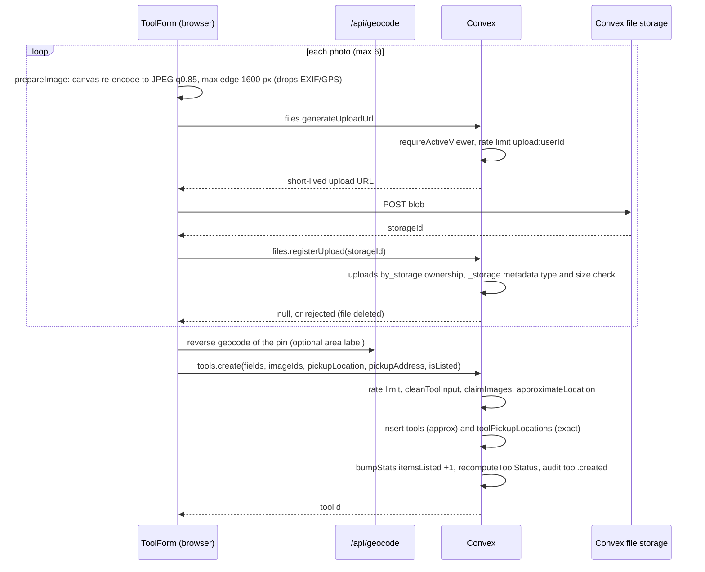

**Image upload** (`src/hooks/useImageUpload.ts`, `src/lib/images.ts`, `convex/files.ts`)
1. **`prepareImage`** rejects non-images and inputs over 25 MB. It re-encodes through a canvas to JPEG (quality 0.85, longest edge ≤ 1600 px), which strips all metadata, including GPS. Output over 5 MB is rejected.
2. **`files.generateUploadUrl`** (`requireActiveViewer`, rate limit `upload:{userId}`) returns `ctx.storage.generateUploadUrl()`. The browser POSTs the blob straight to Convex storage and receives a `storageId`.
3. **`files.registerUpload({ storageId })`** (`requireActiveViewer`) records ownership.
   - If an `uploads` row already exists (`by_storage`) for another user, it throws `FORBIDDEN`. If the row is the caller's, it is a no-op.
   - It reads `ctx.db.system.get(storageId)`. If the type is not JPEG, PNG or WebP, or the size is over 5 MB, it deletes the file and returns `{ rejected: true, message }`.
   - Otherwise it inserts `uploads { ownerId, contentType, size, attached: false }`.
4. **Orphans.** Uploads that are never attached are deleted after 24 h by `scheduled.housekeeping`.

**`tools.create`**
1. `requireActiveViewer`, then the rate limit `tool:create:{userId}`.
2. **`cleanToolInput` validation:**
   - name 3–80 characters; description 10–2000; pickupArea 2–80;
   - a valid `pickupLocation`;
   - `maxLoanDays` an integer from 1 to 30;
   - deposit from 0 to 100000;
   - `availableUntil > availableFrom`;
   - address ≤ 200, instructions ≤ 1000, terms ≤ 500.
3. **`claimImages(ctx, userId, imageIds, { min: 1, max: 6 })`** rejects duplicates. Every ID must have an `uploads` row owned by the caller. Each row is set to `attached: true`.
4. **`approximateLocation(pickupLocation)`** (`convex/lib/geo.ts`) snaps the point to the centre of a 0.004° grid cell (≈ 440 m north-south; the longitude width depends on the latitude band). It adds a random offset of up to ±35 % of the cell and rounds to 5 decimals.
5. **Writes:**
   - inserts `tools` with only `approxLat`/`approxLng`, `searchText = buildSearchText(...)`, `isListed` (default `true`), `status` `AVAILABLE` or `UNAVAILABLE`, and `discoverable`;
   - inserts `toolPickupLocations { toolId, ownerId, lat, lng, address }` with the **exact** point.
6. **Side effects:** `bumpStats(owner, { itemsListed: +1 })`, `recomputeToolStatus`, audit `tool.created`. No notification is sent.

**`tools.update`**
1. `requireActiveViewer` and `requireOwnedTool`. The owner or an admin may proceed; anyone else gets `NOT_FOUND`.
2. **Validation and images:** the same `cleanToolInput`. `claimImages` runs against the **owner's** uploads, and images already on the tool are accepted.
3. **Pickup move.** The location counts as moved if `|Δ| > 1e-7`.
   - A move is refused (`INVALID_STATE`) while any blocking loan exists.
   - The approximate point is recomputed only on a move, so re-saving does not re-jitter the public pin.
4. **Dropped images:** `releaseImages` deletes both the `uploads` row and the stored file, but only for files the owner uploaded.
5. **Writes and audit:** patches `tools`; patches or inserts `toolPickupLocations`; writes `tool.updated` with `meta.locationChanged` and actor `USER` or `ADMIN`.

`tools.update` has no rate limit and does not recompute status, because none of the fields it changes affect the status.

**Pause, resume and delete**
- **`tools.setListed`** is owner-only; an admin gets `FORBIDDEN`. It flips `isListed`. Unlisting declines every `PENDING` request through `declinePendingRequests`: status `DECLINED`, a `REQUEST_DECLINED` notification, and the audit `request.declined` with `meta.automatic`. It then runs `recomputeToolStatus` and writes `tool.listed` or `tool.unlisted`.
- **`tools.remove`** is owner-only. It refuses (`INVALID_STATE`) while any blocking loan exists, and otherwise:
  - declines pending requests;
  - soft-deletes (`removedAt`, `removedBy`, `removedReason`);
  - applies `itemsListed −1`;
  - recomputes status (`REMOVED`) and writes `tool.removed`.
- **Client:** `tools.mine` (`/listings`) and the discovery map update live.

### 3.6 Create a borrow request

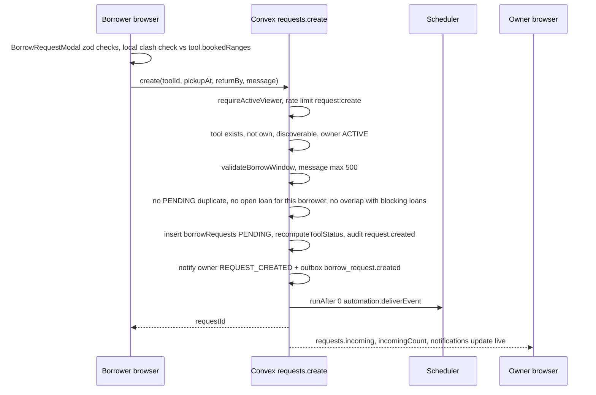

1. **Client.** `BorrowRequestModal` validates with Zod (`borrowRequestSchema(maxLoanDays)`). It warns about overlaps with `tool.bookedRanges` from `tools.get`. The server is still authoritative.
2. **Auth and rate limit:** `requireActiveViewer`, then `request:create:{userId}`.
3. **Tool checks:** the tool must exist and not be removed (else `NOT_FOUND`); a borrower cannot request their own tool (`FORBIDDEN`); the tool must be `discoverable` and the owner `ACTIVE` (else `UNAVAILABLE`).
4. **`validateBorrowWindow`** (`convex/lib/rules.ts`) checks, in order:

   | Check | Failure code |
   | --- | --- |
   | Both times are finite | `INVALID_DATES` |
   | `pickupAt ≥ now − 5 min` | `START_IN_PAST` |
   | `returnBy > pickupAt` | `END_BEFORE_START` |
   | `pickupAt ≤ now + 90 d` | `TOO_FAR_AHEAD` |
   | Duration ≤ `min(maxLoanDays, 30)` days | `TOO_LONG` |
   | Window inside `availableFrom`..`availableUntil` | `OUTSIDE_AVAILABILITY` |

   A failure throws `INVALID_INPUT` with `reason` set to the failure code.
5. **Uniqueness and overlap:**
   - a `PENDING` row in `borrowRequests.by_borrower_tool_status` → `DUPLICATE`;
   - an open loan for the same borrower → `DUPLICATE`;
   - `findConflict` against `openLoansForTool`, which queries `loans.by_tool_status` for every `BLOCKING_LOAN_STATUSES` value, using half-open intervals → `CONFLICT`.
6. **Writes:** inserts `borrowRequests { status: "PENDING" }`; `recomputeToolStatus` (`AVAILABLE` → `PENDING_REQUEST`); audit `request.created`.
7. **Notification:** `notify(owner, REQUEST_CREATED)` writes a `notifications` row, an `automationEvents` row (`borrow_request.created`) and schedules delivery (§3.14).

Several borrowers may hold `PENDING` requests for the same dates. Only approved, non-terminal loans block the calendar.

### 3.7 Approve, decline, cancel, expire

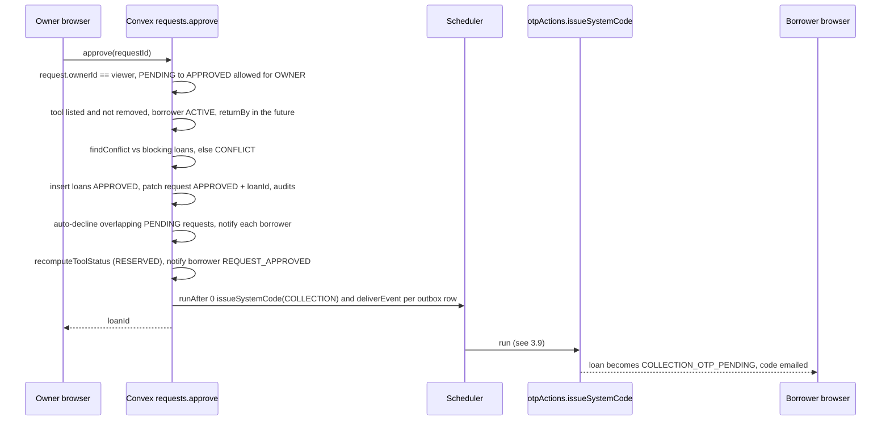

**`requests.approve`** runs as one serialisable transaction.
1. `requireActiveViewer`. A request owned by someone else → `NOT_FOUND`.
2. `assertRequestTransition(PENDING → APPROVED, OWNER)`. On failure: `INVALID_STATE`, "already processed".
3. **Tool and borrower checks:**
   - the tool exists, is not removed and is still owned by the viewer;
   - `isListed` is true ("Re-enable the listing…");
   - the borrower is `ACTIVE`;
   - `returnBy > now`.

   A `pickupAt` already in the past is not rejected here; the expiry cron handles stale requests.
4. **Conflict check:** `findConflict(request, openLoansForTool)` → `CONFLICT`. Concurrent approvals serialise under Convex OCC, so only one can commit.
5. **Writes:**
   - inserts `loans` with `status: "APPROVED"`, a snapshot of `toolName`/`toolCategory`, and `wasOverdue: false`;
   - patches the request to `APPROVED` with `loanId`;
   - audits `request.approved` and `loan.created`.
6. **Auto-decline.** Every other `PENDING` request on the tool that overlaps (`by_tool_status`) becomes `DECLINED` with "Those dates were booked by another neighbour.". Each gets a `SYSTEM` audit `request.declined` (`meta.reason: date_conflict`) and a `REQUEST_DECLINED` notification.
7. **Wrap-up:** `recomputeToolStatus` (`RESERVED`); notify the borrower `REQUEST_APPROVED` with path `/loans/{loanId}`; `scheduler.runAfter(0, otpActions.issueSystemCode, { purpose: "COLLECTION" })`.

**`requests.decline`** (owner)
- Transition `PENDING → DECLINED` (`OWNER`); optional reason ≤ 500 characters.
- Patch, `recomputeToolStatus`, audit.
- Notifies the borrower `REQUEST_DECLINED` (outbox `borrow_request.declined`).

**`requests.cancel`** (borrower)
- Transition `PENDING → CANCELLED` (`BORROWER`); patch, recompute, audit.
- Notifies the owner `REQUEST_CANCELLED` (outbox `borrow_request.cancelled`).

**Expiry**
- The cron `scheduled.expireStaleRequests` runs every 15 min. It finds `PENDING` requests with `pickupAt < now` (`by_status_pickup`, batches of 100, self-rescheduling).
- Each becomes `EXPIRED`, gets the `SYSTEM` audit `request.expired`, and the borrower is notified `REQUEST_EXPIRED` (outbox `borrow_request.expired`).
- The affected tools are then recomputed.

**Other `PENDING` exits.** These write the status directly instead of calling `assertRequestTransition`; each filters on `status === "PENDING"` first:
- `tools.setListed(false)` and `tools.remove`: `DECLINED`;
- `admin.removeTool`: `DECLINED`;
- `admin.setStatus(SUSPENDED)`: `CANCELLED`, with no notification.

**What the client sees**
- **Borrower:** `requests.mine` re-tabs through `borrowerTabFor`, then `notifications` and `loans.listActive` update.
- **Owner:** `requests.incoming` and `incomingCount` update.
- **Everyone:** the map pin changes to `RESERVED`.

### 3.8 Loan state machine

The source of truth is `LOAN_TRANSITIONS` in `convex/lib/stateMachine.ts`, enforced by `transitionLoan`.

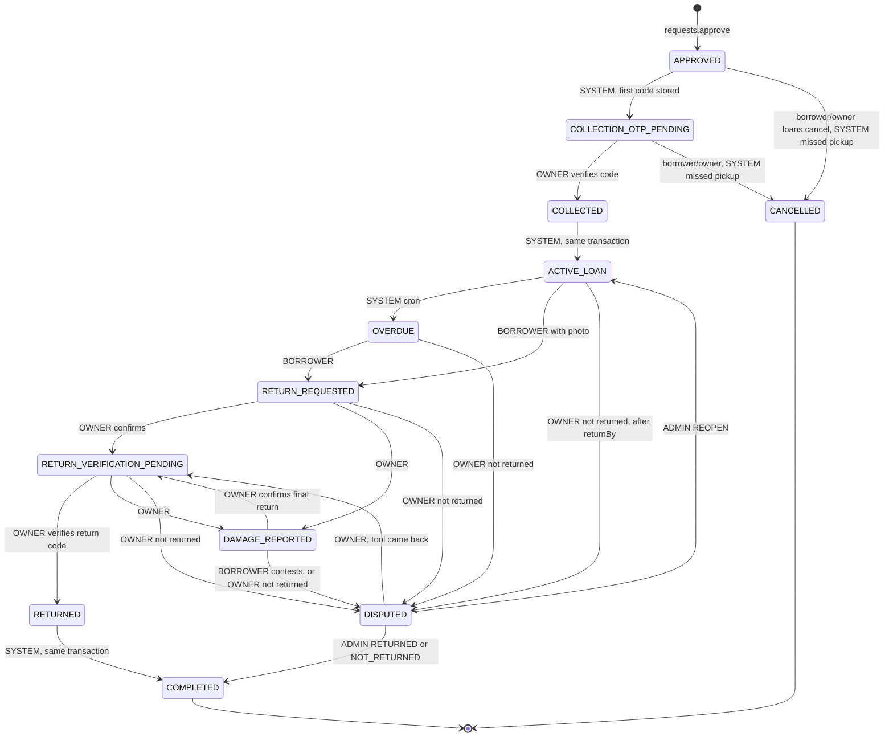

| From → To | Actors allowed by the table | Performed by |
| --- | --- | --- |
| APPROVED → COLLECTION_OTP_PENDING | SYSTEM | `otp.storeCode` when the first collection code is stored (system or on-demand) |
| APPROVED / COLLECTION_OTP_PENDING → CANCELLED | BORROWER, OWNER, ADMIN, SYSTEM | `loans.cancel` (borrower or owner; `loanRoleOf(..., false)` excludes admins); `scheduled.cancelMissedPickups` |
| COLLECTION_OTP_PENDING → COLLECTED → ACTIVE_LOAN | OWNER, then SYSTEM | `otp.consumeCode` → `completeCollection` |
| ACTIVE_LOAN → OVERDUE | SYSTEM | `scheduled.markOverdueLoans` (sets `wasOverdue: true`) |
| ACTIVE_LOAN / OVERDUE → RETURN_REQUESTED | BORROWER | `loans.requestReturn` |
| ACTIVE_LOAN / OVERDUE / RETURN_REQUESTED / RETURN_VERIFICATION_PENDING / DAMAGE_REPORTED → DISPUTED | OWNER, ADMIN (DAMAGE_REPORTED also BORROWER) | `loans.reportNotReturned` (owner); `loans.respondToDamage` CONTEST (borrower) |
| RETURN_REQUESTED / DAMAGE_REPORTED / DISPUTED → RETURN_VERIFICATION_PENDING | OWNER (ADMIN also allowed from DAMAGE_REPORTED and DISPUTED) | `loans.confirmReturnReady` (owner only) |
| RETURN_REQUESTED / RETURN_VERIFICATION_PENDING → DAMAGE_REPORTED | OWNER | `loans.reportDamage` |
| RETURN_VERIFICATION_PENDING → RETURNED → COMPLETED | OWNER, then SYSTEM | `otp.consumeCode` → `completeReturn` |
| DISPUTED → ACTIVE_LOAN / COMPLETED | ADMIN | `admin.resolveDispute` |

Notes:
- **Admin rights are mostly unused.** `ADMIN` appears in more rows of the table than any function exercises. The only admin transitions reachable from code are through `admin.resolveDispute`.
- **Terminal states:** `COMPLETED` and `CANCELLED`. Every other state is in `BLOCKING_LOAN_STATUSES`, so it holds the calendar and prevents moving the pickup point or deleting the tool.
- **Loan actions in the UI.** `loans.get` returns `actions` from `allowedLoanActions(loan, role, …)`, the same rules the mutations enforce, so the UI shows only valid buttons.
- **Tool status is derived** in `deriveToolStatus`, evaluated in this order:
  1. removed → `REMOVED`;
  2. any `COLLECTED`/`ACTIVE_LOAN`/`OVERDUE` loan → `LENT`;
  3. any returning or contested loan → `RETURN_PENDING`;
  4. unlisted, or owner not `ACTIVE` → `UNAVAILABLE`;
  5. any `APPROVED`/`COLLECTION_OTP_PENDING` loan → `RESERVED`;
  6. any `PENDING` request → `PENDING_REQUEST`;
  7. otherwise `AVAILABLE`.

  `discoverable` is true only for `AVAILABLE`, `PENDING_REQUEST` and `RESERVED`. `recomputeToolStatus` patches the tool only when the status or flag changed.
- **Request state machine** (`REQUEST_TRANSITIONS`): `PENDING` → `APPROVED` (OWNER), `DECLINED` (OWNER/SYSTEM), `CANCELLED` (BORROWER/ADMIN/SYSTEM) or `EXPIRED` (SYSTEM). All four are terminal. A loan cancelled later leaves its request `APPROVED`; `borrowerTabFor` files it under the "Cancelled" tab.

### 3.9 Pickup OTP: issue and verify

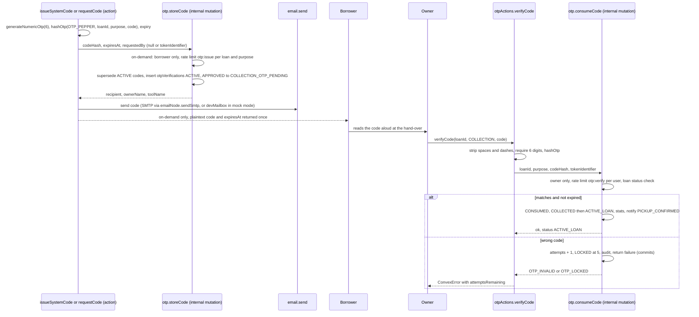

**Issue.** `issue()` in `convex/otpActions.ts` runs in an action, because mutations are deterministic and can't generate secure randomness.
1. `otp.loanForOtp` (internal query) loads `pickupAt`, `status` and `toolName`.
2. `generateNumericOtp(6)` uses `crypto.getRandomValues` with rejection sampling, so there is no modulo bias.
3. `pepper()` requires `OTP_PEPPER` of at least 32 characters, else it throws `CONFIG`; issuance fails closed. `hashOtp` computes `HMAC-SHA256(OTP_PEPPER, "otp:v1:{loanId}:{purpose}:{code}")`.
4. **Expiry** (`OTP_CONFIG`, `collectionOtpExpiry`):

   | Code | Expires at |
   | --- | --- |
   | System collection code | `min(now + 7 d, max(now + 15 min, pickupAt + 24 h))` |
   | On-demand collection code | `now + 15 min` |
   | Return code (system or on-demand) | `now + 30 min` |

5. **`otp.storeCode`** stores the hash.
   - **On-demand calls** (`requestedBy` set): the caller must be `ACTIVE`. The owner gets `FORBIDDEN` ("Codes are shown to the borrower…"); a non-participant gets `NOT_FOUND`. Then the rate limit `otp:issue:{loanId}:{purpose}` applies.
   - **`canIssue`:** collection codes need `APPROVED` or `COLLECTION_OTP_PENDING`; return codes need `RETURN_VERIFICATION_PENDING`. Otherwise system calls return `{ ok: false }` and on-demand calls throw `INVALID_STATE`.
   - **Race guard:** a *system* issuance never replaces an unexpired `ACTIVE` code, because an on-demand code may be on the borrower's screen. It returns `{ ok: false }` instead.
   - **Writes:**
     - marks previous `ACTIVE` codes for that purpose `SUPERSEDED` (`by_loan_purpose_status`);
     - inserts `otpVerifications { codeHash, status: "ACTIVE", attempts: 0, maxAttempts: 5, expiresAt, recipientId: borrower, verifierId: owner }`;
     - for a collection code on an `APPROVED` loan, transitions to `COLLECTION_OTP_PENDING` (`SYSTEM`);
     - writes the audit `otp.issued` with `meta { purpose, recordId, onDemand }`.
   - **Notifications (system issuance only):** `PICKUP_OTP_GENERATED` to the borrower ("Your pickup code is ready") and to the owner ("Pickup is ready"). Neither contains the code, and neither is forwarded to n8n.
6. **Email.** `email.send` runs with `sensitive: true` and `kind` `otp_pickup` or `otp_return`, for both system and on-demand codes, unless the borrower is a seed user.
   - `EMAIL_DELIVERY_MODE=smtp` calls `emailNode.sendSmtp` (nodemailer). It reads `SMTP_HOST`, `SMTP_PORT` (default 587), `SMTP_SECURE === "true"`, `SMTP_USER`, `SMTP_PASS` and `EMAIL_FROM`, with timeouts of 10 s, 10 s and 15 s.
   - Otherwise the message goes to `devMailbox.record`. When `DEPLOYMENT_ENV=production`, a sensitive message throws instead.
   - Delivery failures are caught and logged without the code. The borrower can always reveal a fresh code in the app.
7. **On-demand return value.** `otpActions.requestCode` returns `{ code, expiresAt }` once, to the authenticated borrower (`ShowCodePanel`).

**Verify** (`otpActions.verifyCode`, then `otp.consumeCode`)
1. The action requires an identity. It strips spaces and dashes, requires `^\d{6}$` (else `INVALID_INPUT`), and hashes the code with the pepper.
2. `consumeCode` resolves the user by `tokenIdentifier` (must be `ACTIVE`).
   - A non-participant gets `NOT_FOUND`.
   - **The borrower gets `FORBIDDEN`. Only the owner can verify.**
   - Then the rate limit `otp:verify:{userId}` applies.
3. **Status check.** The loan must be `COLLECTION_OTP_PENDING` (or `RETURN_VERIFICATION_PENDING` for return codes). A collection attempt on an `APPROVED` loan returns `OTP_MISSING`; anything else throws `INVALID_STATE`.
4. **Code lookup:** the newest `ACTIVE` code for the purpose.
   - None, with a `LOCKED` row present → `OTP_LOCKED`. None at all → `OTP_MISSING`.
   - Expired → `OTP_EXPIRED`; attempts are not incremented.
5. **Comparison.** `timingSafeEqual` compares the hashes in constant time.
   - **Mismatch:** `attempts + 1`, with status `LOCKED` once attempts ≥ 5. The audit is `otp.failed_attempt` or `otp.locked`. The mutation **returns** `{ ok: false, code, attemptsRemaining }` so the write commits, and the action then throws `ConvexError` with that code.
   - **Match:** the code becomes `CONSUMED`, the audit `otp.verified` is written, and `completeCollection` runs:
     - `COLLECTED` (`OWNER`, `collectedAt`), then `ACTIVE_LOAN` (`SYSTEM`);
     - `bumpStats`: borrower `borrowingTotal +1`, owner `lendingTotal +1`;
     - `recomputeToolStatus` (`LENT`);
     - notify the borrower `PICKUP_CONFIRMED` (outbox `loan.collected`).
6. **What the client sees.** Both parties' `loans.get` subscriptions update. The owner only ever sees `otp.collection = { expiresAt, expired, attemptsRemaining }`, never a code or a hash.

**Cancellation before pickup.** `loans.cancel` lets the borrower or owner cancel; there is no admin path.
- Optional reason ≤ 500 characters.
- `transitionLoan(CANCELLED)` sets `cancelledAt` and `cancelReason`.
- `supersedeOtps` and `recomputeToolStatus` run.
- The other party is notified `LOAN_CANCELLED` (outbox `loan.cancelled`).

### 3.10 Return and return OTP

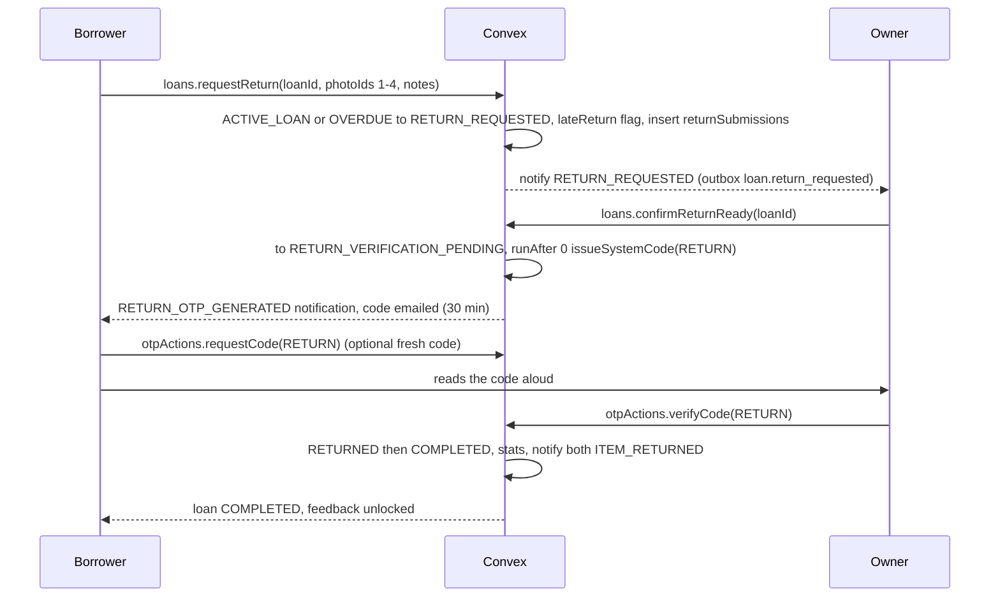

1. **`loans.requestReturn`** (borrower only; others get `NOT_FOUND`).
   - Notes ≤ 500 characters; `claimImages` with 1–4 photos.
   - `transitionLoan(RETURN_REQUESTED, BORROWER)` with `returnRequestedAt`.
   - `lateReturn = isLateReturn(returnBy, now)`, i.e. `now > returnBy + 1 h` (`LATE_RETURN_GRACE_MS`).
   - Inserts `returnSubmissions`, recomputes (`RETURN_PENDING`), and notifies the owner `RETURN_REQUESTED`.
2. **`loans.confirmReturnReady`** (owner only). It transitions to `RETURN_VERIFICATION_PENDING`; this is valid from `RETURN_REQUESTED`, `DAMAGE_REPORTED` and `DISPUTED`. It then recomputes and schedules `issueSystemCode(RETURN)`.
   - The flow is the same as §3.9, with a 30-minute expiry.
   - The borrower is notified `RETURN_OTP_GENERATED`, which is not forwarded to n8n.
3. **Owner verifies the return code** → `completeReturn`:
   - `RETURNED` (`OWNER`, `returnedAt`), then `COMPLETED` (`SYSTEM`, `completedAt`);
   - `bumpStats`: borrower `borrowingCompleted +1`, plus `lateReturns +1` when `lateReturn`; owner `lendingCompleted +1`;
   - `recomputeToolStatus`;
   - notifies `ITEM_RETURNED` to **both** parties, and each notification creates a `loan.returned` outbox row.
4. **Return arrangement.** `loans.setReturnArrangement` (owner, non-terminal loans, note ≤ 1000) stores free text shown on the loan page and audits `loan.return_arrangement_updated`.

### 3.11 Damage reports and disputes

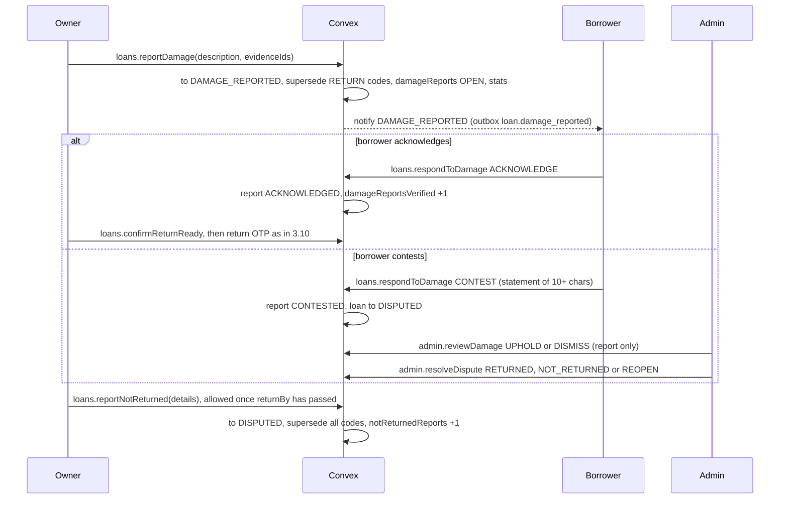

**`loans.reportDamage`** (owner)
- Description 10–2000 characters; `claimImages` with 1–6 evidence photos.
- `transitionLoan(DAMAGE_REPORTED)`, then `supersedeOtps(loan, "RETURN")`.
- Inserts `damageReports { status: "OPEN", reporterId: owner, subjectId: borrower }`, bumps the borrower's `damageReportsReceived +1`, and audits `damage.reported`.
- Recomputes, then notifies the borrower `DAMAGE_REPORTED`.

**`loans.respondToDamage`** (only the report's `subjectId`, while the report is `OPEN`)
- **`ACKNOWLEDGE`:** the report becomes `ACKNOWLEDGED` and the borrower's `damageReportsVerified +1`. The loan stays `DAMAGE_REPORTED` until the owner calls `confirmReturnReady`.
- **`CONTEST`:** requires a statement of at least 10 characters. The report becomes `CONTESTED`, and a `DAMAGE_REPORTED` loan moves to `DISPUTED` with `disputeReason` "Damage report contested".
- Either way it audits `damage.acknowledged` or `damage.contested` and notifies the owner `DAMAGE_RESPONSE`, which is not forwarded to n8n.

**`loans.reportNotReturned`** (owner)
- Details 10–500 characters.
- From `ACTIVE_LOAN` it is refused until `now > returnBy`. The transition table allows it from `ACTIVE_LOAN`, `OVERDUE`, `RETURN_REQUESTED`, `RETURN_VERIFICATION_PENDING` and `DAMAGE_REPORTED`.
- `transitionLoan(DISPUTED, meta { kind: "not_returned" })`, then `supersedeOtps` for all purposes.
- Bumps the borrower's `notReturnedReports +1`, recomputes, and notifies the borrower `NOT_RETURNED_REPORTED`.

**`admin.resolveDispute`** (`DISPUTED` only; note of 5–500 characters)

| Outcome | Effect |
| --- | --- |
| `REOPEN` | Back to `ACTIVE_LOAN` (the overdue cron may flag it again) |
| `RETURNED` | `COMPLETED` with `returnedAt`. Stats as for a normal return; `lateReturns` counts `lateReturn` or `wasOverdue` |
| `NOT_RETURNED` | `COMPLETED`, borrower `notReturnedVerified +1`, and the tool is set to `isListed: false` |

Both parties are notified `ADMIN_ACTION`. The owner can also leave `DISPUTED` without an admin by calling `confirmReturnReady` when the tool turns up.

**`admin.reviewDamage`** (report `OPEN` or `CONTESTED`)
- Sets the report to `UPHELD` or `DISMISSED`; `UPHELD` also bumps `damageReportsVerified +1`.
- Notifies the reporter and the subject. It does **not** change the loan status.

### 3.12 Feedback, reports, trust and reputation

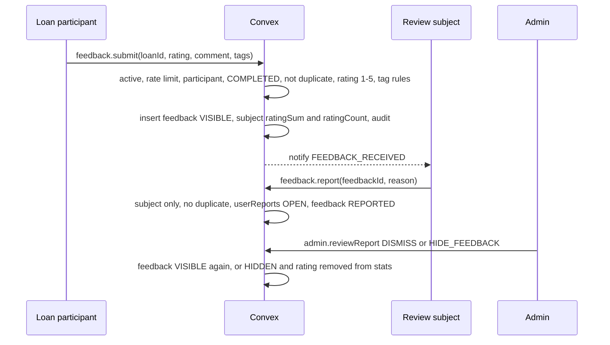

**`feedback.submit`**
1. **Checks:**
   - `requireActiveViewer`, then the rate limit `feedback:{userId}`;
   - the caller must be the borrower or owner (else `NOT_FOUND`);
   - `feedbackEligibility`: the loan is `COMPLETED` and the caller has not already left feedback (`by_loan_author`);
   - rating is an integer from 1 to 5; comment ≤ 1000 characters.
2. **Tag rules** (`validateFeedbackTags`): tags must be unique, at most 5, and fit the direction.
   - Owner-only tags: `RETURNED_GOOD_CONDITION`, `RETURNED_ON_TIME`, `ITEM_DAMAGED`, `RETURNED_LATE`.
   - Borrower-only tag: `ITEM_AS_DESCRIBED`.
3. **Writes:**
   - inserts `feedback { status: "VISIBLE", direction: BORROWER_TO_OWNER | OWNER_TO_BORROWER }`;
   - bumps the subject's `ratingSum` and `ratingCount`;
   - audits `feedback.submitted`;
   - notifies the subject `FEEDBACK_RECEIVED`, which is not forwarded to n8n.

**`feedback.report`** (subject only)
- Rate limit `report:{userId}`; reason 10–500 characters.
- A duplicate report (`by_reporter_target`) is refused.
- Inserts `userReports { targetType: "FEEDBACK", status: "OPEN" }`. A `VISIBLE` review becomes `REPORTED`; it stays visible but is flagged `underReview`.

**`admin.reviewReport`**
- `DISMISS` turns a `REPORTED` review back to `VISIBLE`.
- `HIDE_FEEDBACK` sets the review to `HIDDEN` and subtracts it from the subject's rating stats.
- Notifies the reporter `ADMIN_ACTION`.

**Reputation.** `computeReputation(stats, createdAt, now)` in `convex/lib/rules.ts` computes everything from the denormalised `users.stats`. `bumpStats` updates those counters inside the same transaction as the event that caused them.
- **Average rating:** to 1 decimal, or `null` with no reviews.
- **`verified`:** facts the platform recorded — completed transactions, borrowings, returns, lends, late returns, and confirmed damage and not-returned incidents.
- **`unverified`:** claims nobody has confirmed — `damageReportsReceived − damageReportsVerified` and `notReturnedReports − notReturnedVerified`.
- **`accountAgeDays`** and **`onTimeRate`**: `(borrowingCompleted − lateReturns) / borrowingCompleted`.

Where reputation is shown:

| Surface | Function |
| --- | --- |
| Profile page | `users.reputation` (active viewer; last 30 reviews `by_subject`, `HIDDEN` excluded, first 10 returned; up to 12 discoverable listings) |
| Tool details | `tools.get` (`owner.reputation`) |
| Incoming requests | `requests.incoming` → `borrowerProfile`: the last 5 completed loans, plus up to 10 damage reports, each flagged `verified` when `ACKNOWLEDGED` or `UPHELD` |
| Loan page | `loans.get` (borrower reputation, owner/admin view only) |

**Trusted Lender** is the `users.trustedLender` flag. Only `admin.setTrusted` changes it. Discovery uses it for the `trustedOnly` filter, and the UI shows a badge.

### 3.13 In-app notifications

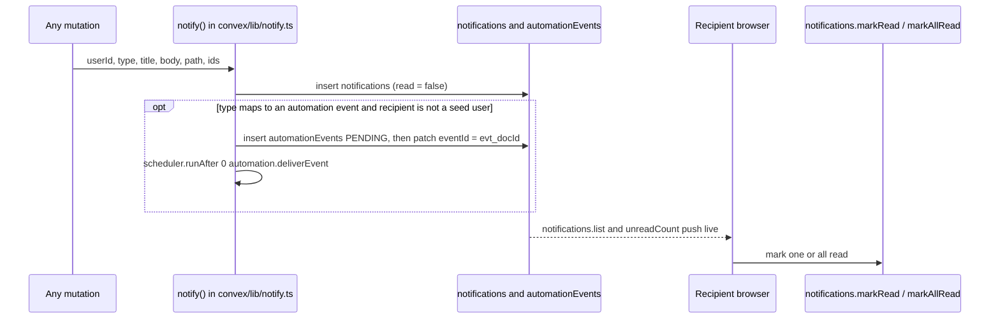

`notify()` runs inside the caller's transaction, so a rolled-back state change never produces a notification or an email.

| Type | Sent by | Recipient(s) | n8n event type |
| --- | --- | --- | --- |
| `REQUEST_CREATED` | `requests.create` | owner | `borrow_request.created` |
| `REQUEST_APPROVED` | `requests.approve` | borrower | `borrow_request.approved` |
| `REQUEST_DECLINED` | `requests.decline`, approve auto-decline, `tools.setListed(false)`, `tools.remove`, `admin.removeTool` | borrower | `borrow_request.declined` |
| `REQUEST_CANCELLED` | `requests.cancel` | owner | `borrow_request.cancelled` |
| `REQUEST_EXPIRED` | `scheduled.expireStaleRequests` | borrower | `borrow_request.expired` |
| `PICKUP_OTP_GENERATED` | `otp.storeCode` (system issuance) | borrower, owner | — (not forwarded) |
| `PICKUP_CONFIRMED` | `otp.consumeCode` | borrower | `loan.collected` |
| `RETURN_REQUESTED` | `loans.requestReturn` | owner | `loan.return_requested` |
| `RETURN_OTP_GENERATED` | `otp.storeCode` (system issuance) | borrower | — |
| `ITEM_RETURNED` | `otp.consumeCode` | borrower, owner | `loan.returned` |
| `DAMAGE_REPORTED` | `loans.reportDamage` | borrower | `loan.damage_reported` |
| `DAMAGE_RESPONSE` | `loans.respondToDamage` | owner | — |
| `NOT_RETURNED_REPORTED` | `loans.reportNotReturned` | borrower | `loan.not_returned_reported` |
| `FEEDBACK_RECEIVED` | `feedback.submit` | subject | — |
| `LOAN_OVERDUE` | `scheduled.markOverdueLoans` | borrower, owner | — (overdue email comes from Workflow B) |
| `LOAN_CANCELLED` | `loans.cancel`, `scheduled.cancelMissedPickups` | other party / both | `loan.cancelled` |
| `ADMIN_ACTION` | `admin.setTrusted`, `setStatus`, `removeTool`, `resolveDispute`, `reviewDamage`, `reviewReport` | affected users | `admin.action` |

**Reading notifications**
- `notifications.list` returns the newest rows (default 30, maximum 100), with optional `unreadOnly`, using `by_user` or `by_user_read`.
- `notifications.unreadCount` counts unread rows, capped at 100.
- `notifications.markRead` checks ownership, else `NOT_FOUND`. `notifications.markAllRead` updates up to 500 rows. Both use `requireViewer`.
- The UI consumers are `NotificationBell`, `/notifications`, the `/more` page and the badges in `AppShell` (`requests.incomingCount`, `loans.activeCount`).

### 3.14 n8n Workflow A: outbox → signed webhook → claim/report

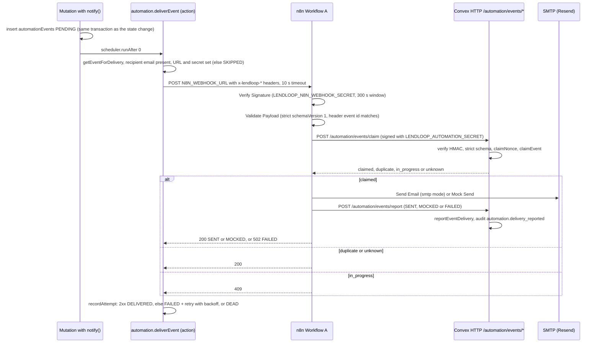

**Outbound, Convex side** (`convex/automation.ts`)
1. **Outbox row.** `notify()` inserts `automationEvents` with `status: "PENDING"` and `attempts: 0`. The payload is `{ title, body, path, toolName?, status? }`. It then sets `eventId = "evt_" + documentId`, which is unique by construction and serves as n8n's idempotency key.
2. **`deliverEvent`** checks before sending:
   - it returns early if the event is already `DELIVERED`, `DEAD` or `SKIPPED`;
   - with no recipient email, it records `SKIPPED`;
   - without `N8N_WEBHOOK_URL` and `N8N_WEBHOOK_SECRET`, it records `SKIPPED` with an explanatory `lastError`.
3. **Payload** (`AutomationWebhookPayload`, `schemaVersion: 1`) contains these fields:
   - `eventId`, `eventType`, `occurredAt` (ISO);
   - `recipient { userId, email, displayName }`;
   - `subject { requestId, loanId, toolId, toolName, status }`;
   - `message { title, body }`;
   - `link = APP_URL + path` (default `http://localhost:3000`).

   **It never contains** OTPs, coordinates, addresses or secrets.
4. **Headers:**

   | Header | Value |
   | --- | --- |
   | `content-type` | `application/json` |
   | `x-lendloop-timestamp` | Unix seconds |
   | `x-lendloop-nonce` | `crypto.randomUUID()` |
   | `x-lendloop-signature` | `sha256=` + hex(HMAC-SHA256(`N8N_WEBHOOK_SECRET`, `` `${ts}.${nonce}.${body}` ``)) |
   | `x-lendloop-event-id` | The `eventId` |

   The request is aborted after 10 s.
5. **`recordAttempt`:**
   - any 2xx → `DELIVERED` (`deliveredAt`);
   - anything else → `attempts + 1`, `FAILED`, `nextAttemptAt`, and `runAfter(retryDelayMs(attempts))`;
   - **Backoff:** 30 s, 2 min, 10 min, 30 min, 2 h, each ±20 % jitter. The 6th failure becomes `DEAD`, which inserts `automationFailures { workflowName: "convex.outbound_delivery" }` and audits `automation.dead_lettered`. Error strings pass through `redactSensitive`.

**Workflow A, n8n side** (`n8n/workflows/lendloop-request-notification.json`; workflow id `lendloopReqNotif`; path `POST /webhook/lendloop-events`; `responseMode: responseNode`)
1. **Verify Signature.** It re-serialises the parsed body with `JSON.stringify`, which matches Convex's compact output, and checks:
   - the secret is at least 32 characters (else `503 not_configured`);
   - all three headers are present;
   - the timestamp has 9–11 digits and is within ±300 s;
   - the nonce is at most 100 characters;
   - `timingSafeEqual` on the signature.

   Any failure → `401`. n8n keeps **no** nonce ledger. A replay inside the window is harmless because the claim turns it into a `duplicate`.
2. **Validate Payload** is strict: every key is required and unknown keys are rejected.
   - `eventId` must match `^evt_[A-Za-z0-9]+$` and the `eventType` must be one of the 12 known types.
   - It checks the email shape, ISO `occurredAt`, an `http(s)` link and control characters, and requires `x-lendloop-event-id` to equal `eventId`.
   - Failure → `400 { error: "invalid_payload", issues }`, listing field paths only.
3. **Claim Event.** `POST {LENDLOOP_CONVEX_SITE_URL}/automation/events/claim { eventId, executionId }`. The request is signed in a Code node and retried 3 times with a 10 s timeout. `automation.claimEvent` answers:

   | Answer | When | Workflow response |
   | --- | --- | --- |
   | `unknown` | No such event | `200`, stop |
   | `duplicate` | `deliveryResult` is already `SENT` or `MOCKED` | `200`, stop |
   | `in_progress` | `claimedAt` is less than 5 min old and no result reported yet | `409`, so Convex retries |
   | `claimed` | Otherwise; sets `claimedAt = now` and clears `deliveryResult` | Continue to step 4 |

4. **Build Email.** Subject = `title` (newlines stripped); text = `body` + a blank line + `link`.
   - `LENDLOOP_EMAIL_MODE=smtp` → **Send Email (SMTP)**, using the n8n credential "LendLoop SMTP" and from address `LENDLOOP_EMAIL_FROM`, with "on error: continue". `SENT` is reported only when the SMTP server accepted the message.
   - Otherwise → **Mock Send**, which reports `MOCKED`.
5. **Report Delivery.** `POST /automation/events/report { eventId, executionId, result, error? }` → `automation.reportEventDelivery`. It sets `deliveryResult`, `deliveryReportedAt` and a redacted `deliveryError`. On `FAILED` it clears `claimedAt` so a retry can claim again.
6. **Respond.** `200` for `SENT` or `MOCKED`; `502` for `FAILED`. If a Convex call still fails after its retries, the workflow responds `502 automation_backend_error` and then **Fail: Convex Call** (`stopAndError`, message `"Claim Event failed for evt_…"` or `"Report Delivery failed for evt_…"`) triggers Workflow C.

**Two status fields.** `automationEvents.status` records whether Convex's webhook call succeeded. `deliveryResult` records what n8n reports about the email itself.

**Inbound endpoint guard.** Every n8n → Convex endpoint is wrapped in `signedEndpoint` (`convex/http.ts`), which applies these checks in order:
1. `AUTOMATION_INBOUND_SECRET` is missing or shorter than 32 characters → `503`.
2. The body is longer than 64 × 1024 characters → `413`.
3. The HMAC check fails (missing headers, bad or stale timestamp, bad signature) or the nonce is over 100 characters → `401`, logged with only the reason.
4. The body is not valid JSON → `400 invalid_json`.
5. The body fails the strict Zod `z.strictObject` schema → `400 invalid_payload`.
6. `automation.claimNonce` finds the nonce already in `webhookEvents.by_nonce` → `409 replayed`. Otherwise it inserts the nonce.
7. The handler runs. Every response carries `cache-control: no-store`.

### 3.15 n8n Workflow B: daily overdue reminders

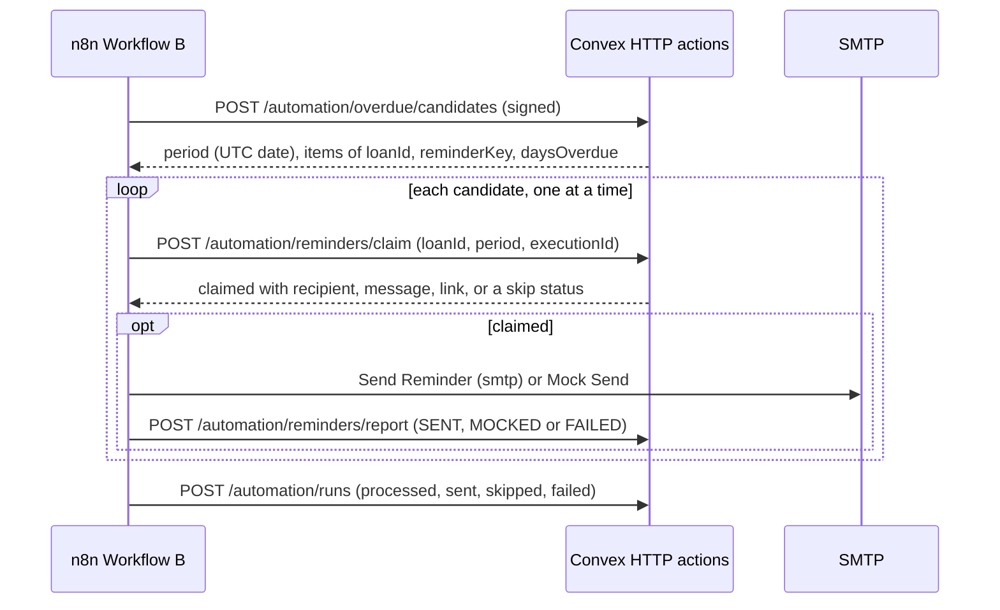

This is `n8n/workflows/lendloop-overdue-reminders.json` (id `lendloopOverdueR`, timezone UTC). It is triggered by a Schedule Trigger with cron `0 9 * * *`, or by **Run Manually**.

1. **Candidates.** `/automation/overdue/candidates { executionId }` calls `automation.overdueCandidates(period = reminderPeriod(now), limit = 100)`. The period is today's UTC date and the caller can override it.
   - It loads `OVERDUE` loans (`loans.by_status`, take 500) and `ACTIVE_LOAN` loans past due (`by_status_returnBy`, take 500).
   - It skips any loan whose reminder `overdue:{loanId}:{period}` (`automationReminders.by_key`) is already `SENT` or `MOCKED`.
2. **Split Candidates** de-duplicates the loan IDs. With no candidates it still reports an empty run.
3. **Claim each reminder.** `/automation/reminders/claim` → `automation.claimReminder`:

   | Answer | When |
   | --- | --- |
   | `unknown` | The loan ID is invalid or the loan is missing |
   | `not_overdue` | The loan is no longer overdue |
   | `skipped` | The borrower is a seed user |
   | `duplicate` | The reminder was already sent |
   | `in_progress` | Another claim is less than 5 min old |
   | `claimed` | Inserts or re-claims the `automationReminders` row (`CLAIMED`, `attempts`, `executionId`) and returns the borrower's email and display name, the subject and body text, and a `link` to `/loans/{id}` |

4. **Send.** The reminder goes through SMTP (credential "LendLoop SMTP") or a mock send.
5. **Report.** `/automation/reminders/report { loanId, period, result, error? }` → `automation.reportReminder` sets the status, `completedAt` and a redacted error.
6. **Run summary.** `/automation/runs` → `automation.recordRun` inserts `automationRuns { workflowName: "lendloop-overdue-reminders", processed, sent, skipped, failed, startedAt, finishedAt }`.

The in-app `LOAN_OVERDUE` notification comes from the Convex cron (§3.17), not from this workflow. If n8n is asleep at 09:00 UTC (Render Free), that day's reminder emails are not sent.

### 3.16 n8n Workflow C: error handler

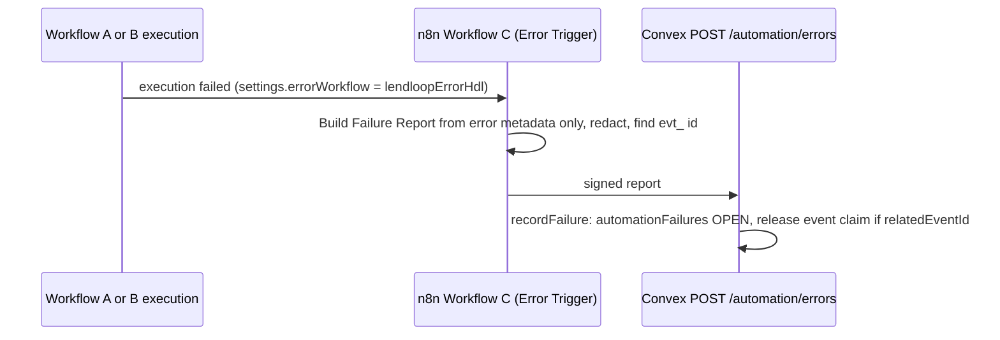

This is `n8n/workflows/lendloop-error-handler.json` (id `lendloopErrorHdl`).
1. **Build Failure Report** reads only the Error Trigger metadata: workflow name, execution ID, last node, and the error message, description and messages. It never reads the failed execution's payload.
2. It redacts secrets, emails, `sha256=` signatures and long digit runs.
3. It extracts `relatedEventId` from any `evt_…` in the message.
4. **`automation.recordFailure`**:
   - truncates each field and redacts `errorMessage` again with `redactSensitive`;
   - inserts `automationFailures { status: "OPEN" }`;
   - if `relatedEventId` names an event whose `deliveryResult` is not `SENT` or `MOCKED`, sets `deliveryResult: "FAILED"` and clears `claimedAt` so the next retry can claim it.
5. **Where it shows up.** Admins see these records under *Admin → Automation* and can mark them `RESOLVED` with `admin.resolveFailure`.

### 3.17 Convex crons and scheduled jobs

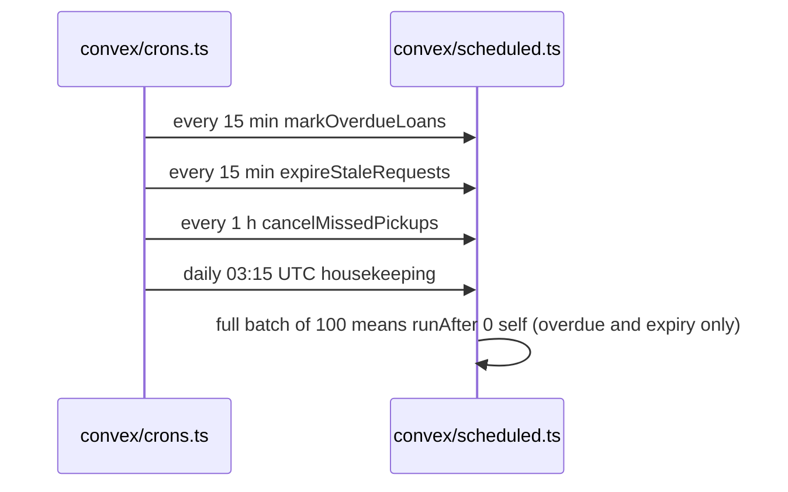

| Cron name | Schedule | Function | What it does |
| --- | --- | --- | --- |
| `mark overdue loans` | `interval { minutes: 15 }` | `scheduled.markOverdueLoans` | Moves `ACTIVE_LOAN` with `returnBy < now` (`by_status_returnBy`, 100 per batch) to `OVERDUE` (`SYSTEM`, `wasOverdue: true`). Recomputes the tool. Notifies both parties `LOAN_OVERDUE`. Re-schedules itself while batches are full |
| `expire stale requests` | `interval { minutes: 15 }` | `scheduled.expireStaleRequests` | `PENDING` requests with `pickupAt < now` become `EXPIRED` (§3.7). Re-schedules itself while batches are full |
| `cancel missed pickups` | `interval { hours: 1 }` | `scheduled.cancelMissedPickups` | For `APPROVED` and `COLLECTION_OTP_PENDING` loans with `pickupAt < now − 48 h` (`by_status_pickup`, 100 per status): cancels with reason "Pickup window passed without collection", supersedes codes, recomputes, notifies both `LOAN_CANCELLED`. **Does not** re-schedule itself |
| `housekeeping` | `daily { hourUTC: 3, minuteUTC: 15 }` | `scheduled.housekeeping` | Deletes `webhookEvents` older than 7 days (`by_received`, ≤ 500); `rateLimits` with a window older than 24 h (≤ 500, filter scan); unattached `uploads` older than 24 h together with their files (`by_attached_created`, ≤ 200); and then runs `devMailbox.purgeExpired` (older than 24 h, ≤ 500) |

Other scheduled work, which is not a cron:
- `automation.deliverEvent`: one per outbox row, plus each backoff retry, plus `admin.retryEvent`.
- `otpActions.issueSystemCode`: after `requests.approve` and after `loans.confirmReturnReady`.

### 3.18 Admin operations

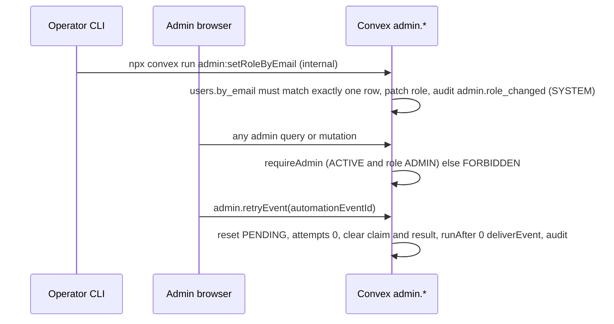

- **Roles.** No client-callable function changes `role`. `admin.setRoleByEmail` is an `internalMutation`, run with `npx convex run [--prod] admin:setRoleByEmail '{"email":…,"role":"ADMIN"}'`. It throws when no user or more than one user has that email.
- **The `/admin` page** (`src/app/(authenticated)/admin/page.tsx`) checks `viewer.role` only as a UI hint. Every function in `convex/admin.ts` calls `requireAdmin`.

| Tab | Functions | Server behaviour |
| --- | --- | --- |
| Overview | `admin.overview` | Counts (each capped at 1000): users, suspended users, discoverable tools, `DISPUTED` and `DAMAGE_REPORTED` loans, open and contested damage reports, open reports, open automation failures, `DEAD` events |
| Users | `admin.users`, `admin.setTrusted`, `admin.setStatus` | `users` filters in memory over the newest 500 users (by name or email). `setStatus`: an admin cannot change their own status; suspending requires a 5–500 character note, cancels the user's `PENDING` requests, and recomputes every tool they own (their listings leave discovery). Writes audit and `ADMIN_ACTION` |
| Listings | `admin.tools`, `admin.removeTool`, `admin.restoreTool` | `removeTool` (note required) soft-deletes, declines pending requests, applies `itemsListed −1`, and notifies the owner. It does **not** check open loans. `restoreTool` clears the removal and recomputes |
| Loans | `admin.loans` | The newest 200 loans, optionally filtered by status (`by_status`) |
| Disputes | `admin.disputes`, `admin.resolveDispute` | `DISPUTED` and `DAMAGE_REPORTED` loans with their damage reports; resolution as in §3.11 |
| Damage | `admin.damageReports`, `admin.reviewDamage` | Includes evidence URLs; uphold or dismiss |
| Reported feedback | `admin.reports`, `admin.reviewReport` | Open `userReports` with the reported review |
| Automation | `admin.automation`, `admin.retryEvent`, `admin.resolveFailure` | Shows config flags (`N8N_WEBHOOK_URL` + secret set, `AUTOMATION_INBOUND_SECRET` set, email mode), failures, `DEAD`/`FAILED`/`SKIPPED` events, recent events, runs and reminders. `retryEvent` refuses events already delivered unless `deliveryResult === "FAILED"` |
| Audit log | `admin.auditLogs` | The newest 100 rows (maximum 300), optionally filtered by `resourceType` from the newest 1000 |

### 3.19 Seed data

```mermaid
sequenceDiagram
  participant Op as Developer
  participant X as Convex seed.*
  participant S as File storage
  Op->>X: npx convex run seed:run (requires SEED_ENABLED=true)
  X->>X: insert seed users, tools, pickup points, history, feedback, current loans (isSeed true)
  Op->>X: node scripts/seed-images.mjs calls seed:imageUploadUrl
  Op->>S: POST JPEG
  Op->>X: seed:attachImages(key, storageIds, credits)
  Op->>X: seed:reset removes seed-marked data
```

All seed functions in `convex/seed.ts` are `internalMutation`s. They throw unless `SEED_ENABLED === "true"`.

**`seed:run`** is idempotent: it skips when a seed user already exists. It creates a sample neighbourhood around Indiranagar, Bengaluru (`SEED_NEIGHBORHOOD`), with deterministic coordinates (PRNG `mulberry32`):

| Data | Details |
| --- | --- |
| Users | 8 users with `tokenIdentifier` `seed\|<key>` and `@seed.lendloop.invalid` email addresses. They cannot sign in |
| Tools | 19 tools, one of them unlisted, each with a `toolPickupLocations` row |
| History | 7 `COMPLETED` loans with two-sided feedback; one includes an `ACKNOWLEDGED` damage report |
| Current state | 1 `ACTIVE_LOAN`, 1 `APPROVED` loan with no code issued, and 1 `PENDING` request |

Every row carries `isSeed: true`, and stats are bumped to match the seeded history.

**Other seed functions**
- `seed:refresh` re-syncs tool text.
- `seed:imageUploadUrl` and `seed:attachImages` support `scripts/seed-images.mjs`, which uploads the licensed photos in `seed-assets/tools` and attaches `imageCredits`.
- `seed:reset` deletes seed tools, loans, requests on seed tools, related rows and seed users.
- `npm run seed` runs `convex run seed:run && node scripts/seed-images.mjs`.

**Seed users and delivery**
- `notify()` creates in-app notifications for seed users but never outbox rows.
- `issue()` never emails seed borrowers.
- `claimReminder` returns `skipped` for them.

---

## 4. Data model

The schema is `convex/schema.ts`. Every enumerated field is a validator built from `convex/lib/constants.ts` by `convex/validators/index.ts`. Convex also uses its system tables `_storage` (files) and `_scheduled_functions`.

| Table | Purpose | Key fields | Indexes |
| --- | --- | --- | --- |
| `users` | Profile synced from Clerk; role, status, trust; denormalised `stats` | `tokenIdentifier`, `clerkUserId`, `email`, `name`, `approxLat/Lng` (≈ 1 km), `locationSharing`, `role`, `status`, `trustedLender`, `onboardedAt`, `stats`, `isSeed` | `by_token`, `by_email`, `by_role`, `by_status`, `by_seed` |
| `tools` | Public listing with **approximate** coordinates only | `ownerId`, `name`, `category`, `condition`, `imageIds`, `imageCredits?`, `pickupArea`, `approxLat/Lng`, `maxLoanDays`, `availableFrom/Until`, `isListed`, `status`, `discoverable`, `searchText`, `removedAt/By/Reason` | `by_owner`, `by_status`, `by_discoverable_lat`, `by_discoverable_created`, `by_seed`; search index `search_text` (filter fields `discoverable`, `category`) |
| `toolPickupLocations` | **Exact** pickup point and address, kept apart from `tools` | `toolId`, `ownerId`, `lat`, `lng`, `address?` | `by_tool` |
| `borrowRequests` | Borrow requests | `toolId`, `ownerId`, `borrowerId`, `pickupAt`, `returnBy`, `message?`, `status`, `declineReason?`, `loanId?`, `decidedAt?` | `by_borrower_status`, `by_owner_status`, `by_tool_status`, `by_borrower_tool_status`, `by_status_pickup`, `by_seed` |
| `loans` | Loan state machine with a tool snapshot | `requestId`, `toolId`, `ownerId`, `borrowerId`, `status`, `pickupAt`, `returnBy`, `toolName`, `toolCategory`, `returnArrangement?`, lifecycle timestamps, `wasOverdue`, `lateReturn?`, `dispute*` | `by_borrower_status`, `by_owner_status`, `by_tool_status`, `by_status_returnBy`, `by_status_pickup`, `by_status`, `by_request`, `by_seed` |
| `otpVerifications` | HMAC hashes of hand-over codes | `loanId`, `purpose`, `recipientId`, `verifierId`, `codeHash`, `status`, `attempts`, `maxAttempts`, `expiresAt`, `consumedAt?` | `by_loan_purpose_status`, `by_loan` |
| `returnSubmissions` | The borrower's return photos and notes | `loanId`, `borrowerId`, `photoIds`, `notes?`, `submittedAt` | `by_loan` |
| `damageReports` | Damage evidence, the borrower's response and the admin resolution | `loanId`, `toolId`, `reporterId`, `subjectId`, `description`, `evidenceIds`, `status`, `borrowerResponse?`, `resolutionNote?`, `resolvedBy?` | `by_loan`, `by_subject`, `by_status` |
| `feedback` | One review per author per loan | `loanId`, `authorId`, `subjectId`, `direction`, `rating`, `comment?`, `tags`, `status` | `by_loan_author`, `by_subject`, `by_status` |
| `userReports` | Reports against reviews (the admin queue) | `reporterId`, `targetType`, `targetId`, `reason`, `status`, `reviewedBy?`, `reviewNote?` | `by_status`, `by_reporter_target` |
| `notifications` | In-app notifications | `userId`, `type`, `title`, `body`, `loanId?`, `toolId?`, `requestId?`, `read`, `readAt?` | `by_user`, `by_user_read` |
| `auditLogs` | Append-only audit trail | `actorId?`, `actorType`, `action`, `resourceType`, `resourceId`, `fromStatus?`, `toStatus?`, `meta?` | `by_resource`, `by_actor`, `by_action` |
| `automationEvents` | Outbox for n8n | `eventId`, `eventType`, `recipientId`, ids, `payload`, `status`, `attempts`, `lastAttemptAt?`, `nextAttemptAt?`, `lastError?`, `deliveredAt?`, `claimedAt?`, `deliveryResult?`, `deliveryReportedAt?`, `deliveryError?` | `by_event_id`, `by_status`, `by_loan` |
| `automationReminders` | Ledger with one overdue reminder per loan per UTC day | `loanId`, `period`, `reminderKey`, `status`, `attempts`, `claimedAt`, `completedAt?`, `error?`, `executionId?` | `by_key`, `by_loan` |
| `webhookEvents` | Inbound nonce ledger (replay protection) | `source`, `nonce`, `route`, `relatedEventId?`, `outcome`, `receivedAt` | `by_nonce`, `by_received` |
| `automationFailures` | n8n error-workflow records and dead-lettered outbox events | `workflowName`, `executionId?`, `failedNode?`, `errorMessage`, `relatedEventId?`, `occurredAt`, `status` (`OPEN`/`RESOLVED`) | `by_status` |
| `automationRuns` | Workflow B run summaries | `workflowName`, `executionId?`, `processed`, `sent`, `skipped`, `failed`, `startedAt?`, `finishedAt` | `by_workflow` |
| `uploads` | File ownership ledger | `storageId`, `ownerId`, `contentType`, `size`, `attached` | `by_storage`, `by_owner`, `by_attached_created` |
| `rateLimits` | Fixed-window counters | `key`, `windowStart`, `count` | `by_key` |
| `devMailbox` | Mock email in development (24 h) | `userId`, `to`, `subject`, `text`, `kind` | `by_user` |

**Enumerations** (`convex/lib/constants.ts`, `convex/validators/index.ts`)

| Enumeration | Values |
| --- | --- |
| Tool status | `AVAILABLE`, `PENDING_REQUEST`, `RESERVED`, `LENT`, `RETURN_PENDING`, `UNAVAILABLE`, `REMOVED` |
| Request status | `PENDING`, `APPROVED`, `DECLINED`, `CANCELLED`, `EXPIRED` |
| Loan status | `APPROVED`, `COLLECTION_OTP_PENDING`, `COLLECTED`, `ACTIVE_LOAN`, `OVERDUE`, `RETURN_REQUESTED`, `RETURN_VERIFICATION_PENDING`, `RETURNED`, `COMPLETED`, `CANCELLED`, `DAMAGE_REPORTED`, `DISPUTED` |
| OTP status | `ACTIVE`, `CONSUMED`, `SUPERSEDED`, `LOCKED` |
| OTP purpose | `COLLECTION`, `RETURN` |
| Outbox status | `PENDING`, `DELIVERED`, `FAILED`, `DEAD`, `SKIPPED` |
| Delivery result | `SENT`, `MOCKED`, `FAILED`, `SKIPPED` |
| Reminder status | `CLAIMED`, `SENT`, `MOCKED`, `FAILED` |
| Damage report status | `OPEN`, `ACKNOWLEDGED`, `CONTESTED`, `UPHELD`, `DISMISSED` |
| Dispute outcome | `RETURNED`, `NOT_RETURNED`, `REOPEN` |
| Feedback status | `VISIBLE`, `REPORTED`, `HIDDEN` |
| User report status | `OPEN`, `DISMISSED`, `ACTIONED` |
| User report target | `FEEDBACK`, `USER`, `TOOL` (only `FEEDBACK` is used) |
| Role | `USER`, `ADMIN` |
| Account status | `ACTIVE`, `SUSPENDED` |

**Declared but not queried by the current code:** `users.by_role`, `tools.by_status`, `loans.by_request`, `feedback.by_status`, `auditLogs.by_actor`, `auditLogs.by_action`, `automationEvents.by_loan`, `automationReminders.by_loan`, `automationRuns.by_workflow` and `uploads.by_owner`. Some scans run without an index: `rateLimits` and `devMailbox` in the purge jobs, and the admin `users` and `tools` lists, which use `.order("desc").take(n)`.

---

## 5. Function and route catalogue

Auth legend:

| Code | Meaning |
| --- | --- |
| `none` | No check |
| `viewer?` | `getViewer`; returns `null`, `[]` or `0` when signed out |
| `viewer` | `requireViewer` |
| `active` | `requireActiveViewer` |
| `admin` | `requireAdmin` |
| `identity` | Raw `ctx.auth` identity; authorisation happens in the internal mutation it calls |
| `internal` | Not callable from clients |

### 5.1 Public Convex functions (callable from the browser)

| Function | Type | Auth | Purpose |
| --- | --- | --- | --- |
| `users.ensureCurrent` | mutation | identity | Create or refresh the profile from JWT claims |
| `users.me` | query | viewer? | The viewer's own full profile and reputation |
| `users.updateProfile` | mutation | viewer | Edit profile and coarse location; complete onboarding |
| `users.reputation` | query | active | Another member's public profile, reputation, reviews and listings |
| `tools.create` | mutation | active | Create a listing (§3.5) |
| `tools.update` | mutation | active (owner or admin) | Edit a listing |
| `tools.setListed` | mutation | active (owner) | Pause or resume |
| `tools.remove` | mutation | active (owner) | Soft-delete |
| `tools.discover` | query | viewer | Map and list discovery (§3.2) |
| `tools.get` | query | viewer | Listing details, without the exact location |
| `tools.mine` | query | viewer? | The owner's listings with counts and open loans |
| `tools.getForEdit` | query | viewer (owner, else `null`) | Edit form, including the private pickup point |
| `tools.publicPreview` | query | none | Landing-page allow-list (§3.3) |
| `files.generateUploadUrl` | mutation | active | Short-lived storage upload URL |
| `files.registerUpload` | mutation | active | Claim ownership of an uploaded file and validate it |
| `requests.create` / `cancel` / `approve` / `decline` | mutation | active | Request lifecycle (§3.6, §3.7) |
| `requests.mine` | query | viewer? | The borrower's requests, with tab classification |
| `requests.incoming` | query | viewer? | The owner's requests (default `PENDING`) with borrower track records |
| `requests.incomingCount` | query | viewer? | Badge (at most 100) |
| `loans.get` | query | viewer? (participant or admin, else `null`) | Loan detail: exact pickup while live, OTP state, timeline, allowed actions |
| `loans.listActive` / `history` / `activeCount` | query | viewer? | Non-terminal loans, terminal loans, and the badge count |
| `loans.cancel` | mutation | active (borrower or owner) | Cancel before pickup |
| `loans.requestReturn` | mutation | active (borrower) | Start the return with photos |
| `loans.confirmReturnReady` | mutation | active (owner) | Move to return verification and issue the return code |
| `loans.reportDamage` | mutation | active (owner) | File a damage report |
| `loans.respondToDamage` | mutation | active (subject) | Acknowledge or contest |
| `loans.reportNotReturned` | mutation | active (owner) | Open a not-returned dispute |
| `loans.setReturnArrangement` | mutation | active (owner) | Set the return note |
| `otpActions.requestCode` | action | identity (borrower) | Issue a fresh code and return the plaintext once |
| `otpActions.verifyCode` | action | identity (owner) | Verify the code the borrower reads out |
| `feedback.submit` / `report` | mutation | active | Leave a review; report one about you |
| `notifications.list` / `unreadCount` | query | viewer? | Notification centre and badge |
| `notifications.markRead` / `markAllRead` | mutation | viewer | Mark notifications read |
| `devMailbox.mine` | query | viewer? | The viewer's mock emails (empty unless mock mode is on) |
| `admin.overview` / `users` / `tools` / `loans` / `disputes` / `damageReports` / `reports` / `automation` / `auditLogs` | query | admin | Admin views (§3.18) |
| `admin.setTrusted` / `setStatus` / `removeTool` / `restoreTool` / `resolveDispute` / `reviewDamage` / `reviewReport` / `retryEvent` / `resolveFailure` | mutation | admin | Admin actions (§3.18) |

### 5.2 Internal Convex functions

| Function | Type | Purpose |
| --- | --- | --- |
| `otp.loanForOtp` | internalQuery | Minimal loan fields for issuing a code |
| `otp.storeCode` | internalMutation | Store a hash, supersede old codes, transition, notify |
| `otp.consumeCode` | internalMutation | Compare hashes and apply the hand-over transition atomically |
| `otpActions.issueSystemCode` | internalAction | Scheduled code issuance |
| `email.send` | internalAction | Mock or SMTP dispatcher for sensitive mail |
| `emailNode.sendSmtp` | internalAction (`"use node"`) | Nodemailer SMTP send |
| `devMailbox.record` / `purgeExpired` | internalMutation | Mock mailbox write and purge |
| `automation.getEventForDelivery` | internalQuery | Outbox row plus recipient |
| `automation.deliverEvent` | internalAction | Signed POST to n8n |
| `automation.recordAttempt` | internalMutation | Delivery bookkeeping, backoff and dead-lettering |
| `automation.claimNonce` | internalMutation | Inbound replay protection |
| `automation.claimEvent` / `reportEventDelivery` | internalMutation | Event dedup lease and delivery result |
| `automation.overdueCandidates` | internalQuery | Overdue loans that still need today's reminder |
| `automation.claimReminder` / `reportReminder` | internalMutation | Reminder idempotency ledger |
| `automation.recordRun` / `recordFailure` | internalMutation | Workflow run summaries and error records |
| `scheduled.markOverdueLoans` / `expireStaleRequests` / `cancelMissedPickups` / `housekeeping` | internalMutation | Cron jobs (§3.17) |
| `admin.setRoleByEmail` | internalMutation | Role assignment from the CLI |
| `seed.run` / `reset` / `refresh` / `imageUploadUrl` / `attachImages` | internalMutation | Seed data (`SEED_ENABLED=true`) |

### 5.3 Convex HTTP routes (`convex/http.ts`, served at `https://<deployment>.convex.site`)

| Path | Method | Auth | Body (strict) | Handler → response |
| --- | --- | --- | --- | --- |
| `/health` | GET | none | — | `{ ok: true, service: "lendloop-convex" }` |
| `/automation/events/claim` | POST | HMAC + nonce | `{ eventId, executionId? }` | `claimEvent` → `{ status }` |
| `/automation/events/report` | POST | HMAC + nonce | `{ eventId, executionId?, result: SENT/MOCKED/FAILED/SKIPPED, error? }` | `reportEventDelivery` → `{ ok }` |
| `/automation/overdue/candidates` | POST | HMAC + nonce | `{ period?, limit? (1–200), executionId? }` | `overdueCandidates` → `{ period, items }` |
| `/automation/reminders/claim` | POST | HMAC + nonce | `{ loanId, period, executionId? }` | `claimReminder` → `{ status, … }` |
| `/automation/reminders/report` | POST | HMAC + nonce | `{ loanId, period, result: SENT/MOCKED/FAILED, error?, executionId? }` | `reportReminder` → `{ ok }` |
| `/automation/runs` | POST | HMAC + nonce | `{ workflowName, executionId?, processed, sent, skipped, failed, startedAt? }` | `recordRun` → `{ ok }` |
| `/automation/errors` | POST | HMAC + nonce | `{ workflowName, executionId?, failedNode?, errorMessage, relatedEventId?, occurredAt? }` | `recordFailure` → `{ ok }` |

The n8n side exposes one inbound route: `POST /webhook/lendloop-events` (Workflow A).

### 5.4 Next.js routes

| Route | Kind | Access | Main data |
| --- | --- | --- | --- |
| `/` | page (`(public)/page.tsx` → `Landing`) | public | `tools.publicPreview`; `users.me` when signed in; `/api/geocode` |
| `/sign-in/[[...sign-in]]`, `/sign-up/[[...sign-up]]` | page | public | Clerk components |
| `/onboarding` | page | authenticated, rendered without `AppShell` | `users.updateProfile` |
| `/explore` | page | authenticated | `tools.discover`, `tools.get`, `requests.create` |
| `/listings` | page | authenticated | `tools.mine`, `tools.setListed`, `tools.remove` |
| `/listings/new` | page | authenticated | `files.*`, `tools.create` |
| `/listings/[toolId]/edit` | page | authenticated | `tools.getForEdit`, `tools.update` |
| `/requests` | page | authenticated | `requests.mine`, `requests.cancel` |
| `/incoming` | page | authenticated | `requests.incoming`, `approve`, `decline` |
| `/loans` | page | authenticated | `loans.listActive` |
| `/loans/[loanId]` | page | authenticated | `loans.get` and every loan mutation; `otpActions.*`; `feedback.*`; `/api/directions` |
| `/history` | page | authenticated | `loans.history` |
| `/notifications` | page | authenticated | `notifications.*` |
| `/profile` | page | authenticated | `users.reputation`, `users.updateProfile` |
| `/users/[userId]` | page | authenticated | `users.reputation` |
| `/admin` | page | authenticated; admin UI only for `role === "ADMIN"` | `admin.*` |
| `/dev/mailbox` | page | authenticated | `devMailbox.mine` |
| `/more` | page | authenticated (mobile menu) | `devMailbox.mine`, `notifications.unreadCount`, `requests.incomingCount` |
| `/api/geocode` | route handler `GET` | public, IP rate limit | §3.4 |
| `/api/directions` | route handler `GET` | Clerk session | §3.4 |
| `error.tsx`, `not-found.tsx` | boundaries | — | Generic error and 404 |

"Authenticated" means the `(authenticated)/layout.tsx` server redirect plus `AuthGate`. `AppShell` (navigation, `NotificationBell`, `UserMenu`) also subscribes to `loans.activeCount`, `requests.incomingCount`, `notifications.*` and `devMailbox.mine`.

---

## 6. Security and privacy

| Topic | What the code does | Where |
| --- | --- | --- |
| Authorisation boundary | Every Convex function re-derives the user from the JWT. Writes require `ACTIVE`; admin functions require `requireAdmin`; ownership and participant checks return `NOT_FOUND` rather than `FORBIDDEN` where existence would leak. No client path sets `role` | `convex/lib/auth.ts`, each module |
| Projections | Queries return explicit shapes (`toolCard`, `userSummary`, admin rows), never raw documents. Display names are shortened to "First L." | `convex/lib/projections.ts` |
| Public coordinates | `tools.approxLat/Lng` comes from `approximateLocation`: a 0.004° grid cell plus random offset (≤ ±35 % of a cell), computed on the server. Clients cannot set it | `convex/lib/geo.ts`, `tools.create/update` |
| Exact pickup reveal | `toolPickupLocations` is read by only two functions. `loans.get` returns it to the borrower, the owner **and admins** (`loanRoleOf` allows admins) while the loan is non-terminal (`APPROVED` through `DISPUTED`). `tools.getForEdit` returns it to the owner | `convex/loans.ts`, `convex/tools.ts` |
| Viewer location | Only a 3-decimal centre is sent to Convex for discovery. The area label is reverse-geocoded at 2 decimals; the profile stores 2 decimals (coarsened again on the server). The borrower's position is sent to `/api/directions` (5 decimals) only to route to an approved pickup. Device coordinates are never stored | `ExploreView`, `useAreaLabel`, `users.updateProfile`, `PickupCard` |
| Photos | Re-encoded through a canvas before upload, which removes EXIF and GPS. The server re-checks type and size. The `uploads` ledger ensures only the uploader can attach a file. Storage URLs are unguessable but public | `src/lib/images.ts`, `convex/files.ts` |
| OTP hashing | 6 digits, uniform. Only `HMAC-SHA256(OTP_PEPPER, "otp:v1:{loanId}:{purpose}:{code}")` is stored, so a hash is bound to its loan and purpose. Constant-time compare; 5 attempts then `LOCKED`; single use (`CONSUMED`); a new code supersedes older ones. Only the owner can verify. Issue and verify are rate limited. Missing pepper → `CONFIG` (fails closed). Plaintext exists only in the action's memory, the email and the borrower's one-time response | `convex/otp*.ts`, `convex/lib/crypto.ts` |
| Sensitive email | Never via n8n. In mock mode with `DEPLOYMENT_ENV=production`, `email.send` refuses to write codes to `devMailbox`. `devMailbox.mine` shows only the viewer's own mail, only in mock mode, only for 24 h | `convex/email.ts`, `convex/devMailbox.ts` |
| Webhook HMAC | Both directions sign `${timestamp}.${nonce}.${rawBody}` (header `x-lendloop-signature: sha256=…`). ±300 s window; constant-time compare. Convex → n8n uses `N8N_WEBHOOK_SECRET` plus `x-lendloop-event-id`; n8n → Convex uses `AUTOMATION_INBOUND_SECRET` | `convex/lib/crypto.ts`, `convex/http.ts`, workflow Code nodes |
| Replay protection | Inbound: `webhookEvents` nonce ledger (`409` on reuse; rows purged after 7 days). Outbound: no nonce ledger in n8n; replays within the window resolve to `duplicate` through the event claim | `automation.claimNonce` |
| Idempotency | `eventId = evt_<docId>` with a 5-minute claim lease. `reminderKey = overdue:{loanId}:{YYYY-MM-DD}`. Pending-request and feedback uniqueness are checked inside the creating transaction. Approval conflict check plus auto-decline. OTP `CONSUMED` | `convex/automation.ts`, `convex/lib/rules.ts` |
| Data sent to n8n | Event ID and type, timestamp, recipient user ID, email and display name, request/loan/tool IDs, tool name, status, title, body, link. **Never** codes, coordinates, addresses or secrets. Seed users are excluded | `automation.deliverEvent` |
| Log and audit redaction | Audit metadata drops sensitive key segments. `redactSensitive` masks emails, bearer tokens, `sha256=` signatures, `key=value` secrets, coordinates (`[coord]`) and runs of 6+ digits in stored errors. n8n Code nodes redact again | `convex/lib/audit.ts`, `convex/lib/sanitize.ts` |
| HTTP headers | Applied to all paths (`/:path*`) by `next.config.ts`, listed below | `next.config.ts` |
| Secrets | Convex env (pepper, HMAC secrets, SMTP password); Vercel env (Clerk secret key, possibly the Convex deploy key); n8n host env (encryption key, HMAC secrets, DB password) and the encrypted n8n credential "LendLoop SMTP"; GitHub Actions secrets (deploy tokens). Local files `.env*` and `n8n/.env` are git-ignored (except `*.env.example`) | §7 |

**HTTP headers set by `next.config.ts`**

| Header | Value |
| --- | --- |
| `Content-Security-Policy` | `default-src 'self'` (full directives below) |
| `X-Content-Type-Options` | `nosniff` |
| `X-Frame-Options` | `DENY` |
| `Referrer-Policy` | `strict-origin-when-cross-origin` |
| `Permissions-Policy` | `geolocation=(self), camera=(), microphone=(), payment=(), usb=()` |
| `Cross-Origin-Opener-Policy` | `same-origin-allow-popups` |
| `Strict-Transport-Security` (production only) | `max-age=63072000; includeSubDomains; preload` |

Other settings: `poweredByHeader: false`; `images.remotePatterns` allows `**.convex.cloud` and `img.clerk.com`.

**CSP directives** (built by `buildCsp()` in `next.config.ts`):

| Directive | Allows |
| --- | --- |
| `default-src` | `'self'` |
| `script-src` | `'self'`, `'unsafe-inline'` (plus `'unsafe-eval'` in development), Clerk hosts, `challenges.cloudflare.com` |
| `connect-src` | `'self'`; Clerk hosts; `*.convex.cloud` (https and wss); `*.convex.site`; the exact Convex URL and its `ws(s)` form; `clerk-telemetry.com`; `*.protect.clerk.com:*`; Mapbox API, tiles and events hosts; `tiles.openfreemap.org`; origins of any custom map style, tiles or glyph URLs |
| `img-src` | `'self'`, `data:`, `blob:`, `https:` (plus localhost in development) |
| `style-src` | `'self'`, `'unsafe-inline'` |
| `font-src` | `'self'`, `data:` |
| `frame-src` | Cloudflare challenges and Clerk hosts |
| `worker-src`, `child-src` | `'self'`, `blob:` |
| `frame-ancestors` | `'none'` |
| `object-src` | `'none'` |
| `base-uri` | `'self'` |
| `form-action` | `'self'` |

The Clerk Frontend API host is decoded from `NEXT_PUBLIC_CLERK_PUBLISHABLE_KEY`. The headers are computed when `next.config.ts` is loaded, so the Convex, Clerk and map variables must be present **at build time**.

---

## 7. Environments and configuration

Variable names only. "Read by" names the code that consumes each one.

**Vercel (Next.js build and runtime)**

| Variable | Read by | Notes |
| --- | --- | --- |
| `NEXT_PUBLIC_CONVEX_URL` | `src/app/providers.tsx`, `next.config.ts` (CSP) | Build-time; inlined into the client |
| `NEXT_PUBLIC_CLERK_PUBLISHABLE_KEY`, `CLERK_SECRET_KEY` | `@clerk/nextjs`; `next.config.ts` (CSP host) | |
| `NEXT_PUBLIC_CLERK_SIGN_IN_URL`, `NEXT_PUBLIC_CLERK_SIGN_UP_URL`, `NEXT_PUBLIC_CLERK_SIGN_IN_FALLBACK_REDIRECT_URL`, `NEXT_PUBLIC_CLERK_SIGN_UP_FALLBACK_REDIRECT_URL` | Clerk SDK | The same paths are also hard-coded as `ClerkProvider` props |
| `NEXT_PUBLIC_MAPBOX_TOKEN`, `NEXT_PUBLIC_MAPBOX_STYLE_URL` | `src/components/map/mapEngine.ts` | The token selects Mapbox over MapLibre |
| `NEXT_PUBLIC_MAP_STYLE_URL`, `NEXT_PUBLIC_MAP_TILES_URL`, `NEXT_PUBLIC_MAP_GLYPHS_URL` | `MapView.tsx`, `lendloopStyle.ts`, CSP | Only used for MapLibre |
| `GEOCODER_URL`, `GEOCODER_USER_AGENT` | `/api/geocode` | Nominatim policy needs an identifying User-Agent |
| `ROUTING_WALK_URL`, `ROUTING_DRIVE_URL` | `/api/directions` | |
| `CONVEX_DEPLOY_KEY` | Convex CLI | **Not set on Vercel** in the live setup: GitHub Actions deploys Convex. Only needed on Vercel if its build command runs `npx convex deploy --cmd 'npm run build'` (the alternative in `docs/DEPLOY.md`) |
| `CONVEX_DEPLOYMENT`, `NEXT_PUBLIC_CONVEX_SITE_URL` | Convex CLI (local) | Written by `npx convex dev`. `NEXT_PUBLIC_CONVEX_SITE_URL` is not read by `src/` |

**Convex production deployment** (`npx convex env set --prod NAME …`)

| Variable | Read by | Notes |
| --- | --- | --- |
| `CLERK_JWT_ISSUER_DOMAIN` | `convex/auth.config.ts` | Must match the Clerk instance whose keys are on Vercel |
| `OTP_PEPPER` | `convex/otpActions.ts` | ≥ 32 characters, else `CONFIG` |
| `AUTOMATION_INBOUND_SECRET` | `convex/http.ts`, `admin.automation` | ≥ 32 characters, else `503`. Equals n8n's `LENDLOOP_AUTOMATION_SECRET` |
| `N8N_WEBHOOK_URL`, `N8N_WEBHOOK_SECRET` | `automation.deliverEvent`, `admin.automation` | Missing → events `SKIPPED`. The secret equals n8n's `LENDLOOP_N8N_WEBHOOK_SECRET` |
| `APP_URL` | `deliverEvent` and `claimReminder` links | Default `http://localhost:3000` |
| `EMAIL_DELIVERY_MODE` | `email.ts`, `devMailbox.ts`, `admin.automation` | `smtp`, or anything else = mock |
| `SMTP_HOST`, `SMTP_PORT`, `SMTP_SECURE`, `SMTP_USER`, `SMTP_PASS`, `EMAIL_FROM` | `convex/emailNode.ts` | Resend SMTP in the deployed setup |
| `DEPLOYMENT_ENV` | `convex/email.ts` | `production` forbids mock storage of codes |
| `SEED_ENABLED` | `convex/seed.ts` | Development only; `docs/DEPLOY.md` sets it temporarily for a production demo seed |

**Render (n8n service, `n8n/Dockerfile`)**

| Group | Variables |
| --- | --- |
| Host and runtime | `PORT`, `N8N_WEBHOOK_URL`, `N8N_EDITOR_BASE_URL`, `N8N_HOST`, `N8N_PROTOCOL`, `N8N_PROXY_HOPS`, `N8N_ENCRYPTION_KEY` |
| Database (Render Postgres in the live setup; Neon works too) | `DB_TYPE`, `DB_POSTGRESDB_HOST`, `DB_POSTGRESDB_PORT`, `DB_POSTGRESDB_DATABASE`, `DB_POSTGRESDB_USER`, `DB_POSTGRESDB_PASSWORD`, `DB_POSTGRESDB_SSL_ENABLED` |
| LendLoop settings | `LENDLOOP_N8N_WEBHOOK_SECRET`, `LENDLOOP_AUTOMATION_SECRET`, `LENDLOOP_CONVEX_SITE_URL`, `LENDLOOP_EMAIL_MODE`, `LENDLOOP_EMAIL_FROM` |
| Baked into the image (non-secret) | `N8N_PORT`, `N8N_LISTEN_ADDRESS=0.0.0.0` (Render can't route to n8n's IPv6 default `::`), `GENERIC_TIMEZONE`, `TZ`, `NODE_FUNCTION_ALLOW_BUILTIN=crypto`, `N8N_BLOCK_ENV_ACCESS_IN_NODE=false`, telemetry off, `EXECUTIONS_DATA_PRUNE`, `EXECUTIONS_DATA_MAX_AGE=168` |

The image runs `n8n/scripts/start-with-workflows.sh`. It hashes `n8n/workflows/*.json` and compares the hash with the one stored in the `lendloop_meta` table of n8n's Postgres (`n8n/scripts/workflow-marker.cjs`). Only when the files changed (or `LENDLOOP_FORCE_IMPORT=true`) does it import them and publish `lendloopErrorHdl`, `lendloopReqNotif` and `lendloopOverdueR`, which takes ~4 minutes on Render Free's 0.1 CPU. Restarts and wake-ups skip that step and start in well under a minute. Re-importing overwrites edits made in the n8n UI. In the live setup n8n runs with `LENDLOOP_EMAIL_MODE=mock`, because Render Free blocks outbound SMTP ports; the SMTP credential "LendLoop SMTP" would be created in the n8n UI if a host allows SMTP.

**GitHub Actions secrets**

| Secret | Purpose |
| --- | --- |
| `CONVEX_DEPLOY_KEY` | Convex production deploy (deploy key `github-actions-prod`, scoped to the prod deployment) |
| `VERCEL_TOKEN`, `VERCEL_ORG_ID`, `VERCEL_PROJECT_ID` | Vercel prebuilt production deploy |
| `RENDER_API_KEY` | Triggers and polls the n8n redeploy |

**GitHub Actions variables** (non-secret): `APP_URL`, `CONVEX_SITE_URL`, `N8N_URL` (smoke tests), `RENDER_SERVICE_ID`, and `NEXT_PUBLIC_CONVEX_URL`, `NEXT_PUBLIC_CLERK_PUBLISHABLE_KEY`, `NEXT_PUBLIC_MAPBOX_TOKEN` (the CI build).

**Local development**

| File | Contents |
| --- | --- |
| `.env.local` | Next.js variables (template `.env.example`) |
| Convex dev deployment env | Seeded by `scripts/setup-convex-env.sh`: `CLERK_JWT_ISSUER_DOMAIN`, `OTP_PEPPER`, `AUTOMATION_INBOUND_SECRET`, `EMAIL_DELIVERY_MODE`, `APP_URL`, `SEED_ENABLED` |
| `.env.convex.local` | SMTP variables, pushed with `npx convex env set --from-file` |
| `n8n/.env` | Docker Compose variables (template `n8n/.env.example`) |

---

## 8. CI/CD

Two GitHub Actions workflows live in `.github/workflows`. The Vercel project is **not** connected to Git, so the pipeline is the only thing that deploys (no double builds).

```mermaid
flowchart LR
  subgraph CI["ci.yml: PRs, pushes to other branches, and called by deploy.yml"]
    I["npm ci"] --> L["npm run lint"] --> T["npm run typecheck<br/>(app + convex)"] --> U["npm test<br/>(Vitest unit + convex-test)"] --> BLD["npm run build"]
    IMG["docker build n8n/"]
  end
  subgraph CD["deploy.yml: push to main (or manual run)"]
    C1["convex: npx convex deploy -y<br/>CONVEX_DEPLOY_KEY"] --> V1["web: vercel pull → vercel build --prod<br/>→ vercel deploy --prebuilt --prod"]
    R1["n8n: Render API deploy of this commit<br/>(only if n8n/ changed), poll until live"]
    V1 --> S["smoke: APP_URL, CONVEX_SITE_URL/health,<br/>N8N_URL/healthz"]
    R1 --> S
  end
  CI --> C1
  CI --> R1
```

- **`ci.yml`** (`Lint, types, tests, build` and `n8n image builds`): `npm run lint`, `npm run typecheck` (`tsc --noEmit && tsc --noEmit -p convex`), `npm test` (Vitest `unit` + `convex` projects) and `npm run build` with the public `NEXT_PUBLIC_*` values from repository variables; plus `docker build n8n/`. Playwright E2E (`npm run test:e2e`) needs real Clerk users and a running Convex deployment and is run manually.
- **`deploy.yml`** on `main`:
  1. **`ci`**: the whole `ci.yml` via `workflow_call`. Nothing deploys if it fails.
  2. **`convex`**: `npx convex deploy -y` with `CONVEX_DEPLOY_KEY` pushes functions, schema, indexes, crons and HTTP routes to `acrobatic-alpaca-862`. Convex env vars are managed separately (`npx convex env set --prod`).
  3. **`web`** (after `convex`): `vercel pull --environment=production` downloads the project settings and the Vercel env vars; `vercel build --prod` builds in the runner (so the build-time `NEXT_PUBLIC_*` values and CSP come from Vercel's env); `vercel deploy --prebuilt --prod` uploads the output and moves the production alias (`lendloopapp.vercel.app`).
  4. **`n8n`** (in parallel with `convex`/`web`): if `n8n/` changed since the previous push (or the manual run asks for it), `POST /v1/services/{RENDER_SERVICE_ID}/deploys` with this commit, then polls until `live` (fails on `build_failed`/`update_failed`).
  5. **`smoke`**: the home page contains "LendLoop", Convex `/health` returns `"ok":true`, n8n `/healthz` answers (retried for ~2 minutes because Render Free may be asleep).
- Concurrency: deploys are serialised (`deploy-production`, never cancelled mid-way); CI runs for the same ref cancel older ones.
- **Manual run:** Actions → Deploy → Run workflow (tick "Redeploy n8n" to force it).

---

## 9. Notes for reviewers

These behaviours were verified in the code. They are easy to miss or differ slightly from the README:

1. **Exact pickup visibility.** Exact pickup data is also returned to **admins** (`loans.get`) and to the owner (`tools.getForEdit`). The README mentions only the two participants.
2. **`cancelMissedPickups` does not self-reschedule.** It handles at most 100 loans per status per hourly run. `markOverdueLoans` and `expireStaleRequests` do re-schedule themselves.
3. **Unused admin rights.** The state machine gives `ADMIN` several transitions that no function exposes. Admins can change loan status only through `admin.resolveDispute`.
4. **`admin.removeTool` ignores open loans.** The tool becomes `REMOVED` while any loan continues on its snapshot. `tools.remove` (owner) refuses in that case.
5. **Unverified counters never decrease.** The unverified reputation counters are `damageReportsReceived − damageReportsVerified` and `notReturnedReports − notReturnedVerified`. Neither drops when a report is `DISMISSED` or a dispute resolves `RETURNED` or `REOPEN`. Whether that is intended is not documented in code.
6. **Some functions only need `requireViewer`.** `users.updateProfile`, `notifications.markRead`, `notifications.markAllRead`, `tools.discover` and `tools.get` don't require `ACTIVE`, so suspended users can still browse and edit their profile.
7. **Limits are per instance.** The Next.js proxy rate limits and caches are in memory, so they apply per serverless instance.
8. **The body limit counts characters.** The 64 KB inbound limit compares `raw.length` (UTF-16 code units), not bytes.
9. **Codes are emailed for every issuance.** The code email is sent for on-demand codes too, not just system issuance, so each "Show code" press also sends an email.
10. **The OTP pepper is required.** If `OTP_PEPPER` is missing, the scheduled `issueSystemCode` throws and the loan stays `APPROVED`. `verifyCode` then returns `OTP_MISSING`, and `cancelMissedPickups` eventually cancels the loan.

**Deployment facts (2026-11-06)**
- Production uses the Clerk **development** instance (`humble-stork-7162`), because a Clerk production instance needs a domain you own and the app runs on `lendloopapp.vercel.app`. See `docs/PRODUCTION.md`.
- n8n on Render runs in `mock` email mode (Render Free blocks SMTP ports). Hand-over codes are still emailed by Convex over SMTP.
