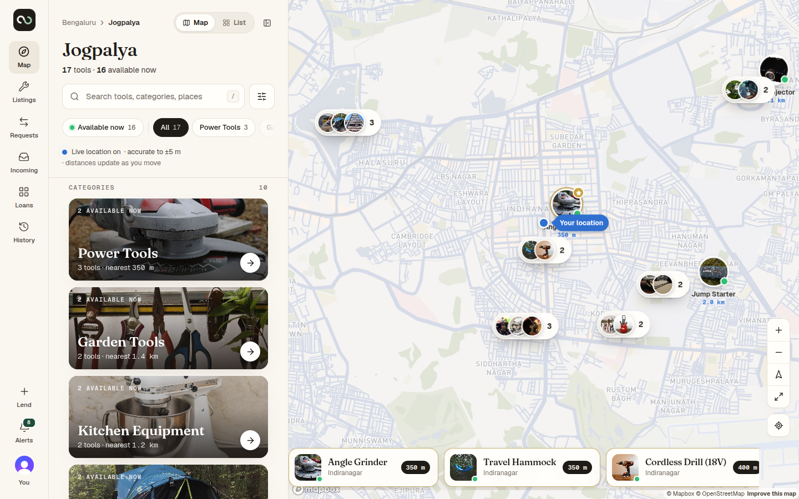
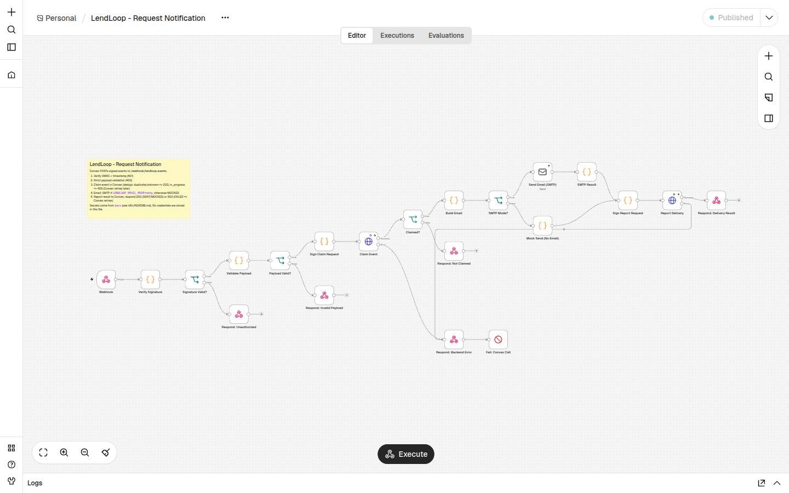
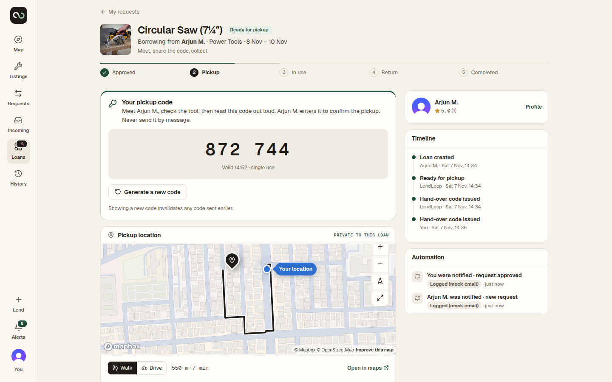

# LendLoop — Take-home submission

**Role:** Full-Stack Developer, Fluence International, Inc.
**Candidate:** Balamurugan Thirugnanasammantham · infobalamurugan22@gmail.com
**Date:** 7 November 2026

| | |
| --- | --- |
| Live app | https://lendloopapp.vercel.app |
| Source code | https://github.com/balamurugan-thiruganasammantham/lendloop |
| n8n (self-hosted, Docker) | https://looplend-n8n.onrender.com |
| Exported n8n workflows | `n8n/workflows/*.json` in the repository |
| Demo accounts (Clerk test mode, code **424242**) | Lender `lendloop.owner+clerk_test@example.com` · Borrower `lendloop.borrower+clerk_test@example.com` |

---

## 1. Summary

LendLoop is a neighbourhood tool-lending board: neighbours list tools they rarely use, others find them on a map, request a date range, hand the tool over in person with a one-time code, return it with a second code, and review each other. n8n sends the request notifications and the daily overdue reminders.

It is built exactly on the requested stack — **Next.js 16 (App Router) + TypeScript, Clerk, Convex, n8n (Docker)** — and is deployed end to end on free tiers with a CI/CD pipeline. My focus was the three things the brief evaluates most: **security-minded design, reliable integration with n8n, and a practical, polished UX**, all documented so another engineer can pick it up.



## 2. Requirements coverage

| Brief | Delivered |
| --- | --- |
| Public page with name, tagline, tools from Convex, no owner details | Landing page with live tool list and map. The public query returns no owner fields; positions are fuzzed (~500 m). |
| "Sign in to lend or borrow" wired to Clerk | Opens Clerk's sign-in-or-up flow (email code or Google). |
| List a tool (name, category, condition, description) | Plus photos (EXIF stripped), a private pickup point and lending terms. |
| Request a date range; approve/decline; mark returned | Overlap-checked requests; approval creates a loan; pickup and return are confirmed with one-time codes. |
| All tools with availability, filterable by category | Map view and list view, category index and chips, distance/condition/availability filters, live distances. |
| My listings · My requests · Incoming requests | Dedicated views with tabs by status. |
| Roles: admin and user, enforced in Convex | `requireAdmin`, ownership and loan-participant checks in every function; admin panel (remove listings, all loans, Trusted Lender, disputes, audit log). |
| n8n: request notification + daily overdue reminders | Two workflows plus an error workflow; signed in both directions; idempotent write-backs; retries. |
| Bonus: automation activity on each loan | "Automation" card on every loan page: "Lender notified · request approved · 2 min ago", reminders. |
| Deliverables | Repository, workflow JSON, README (setup, docker-compose, env vars, architecture, security and data minimisation), production notes, plus `docs/ARCHITECTURE.md`, `docs/DEPLOY.md`, `docs/PRODUCTION.md`. |

## 3. Architecture

```
Browser ──HTTPS──▶ Next.js on Vercel (pages, geocoding/routing proxy routes)
   │  WebSocket + Clerk JWT
   ▼
Convex (queries, mutations, actions, HTTP endpoints, crons, file storage)
   ├── SMTP ──▶ email (hand-over codes)
   └── HMAC-signed webhook ──▶ n8n ──▶ notification email / logged mock
                                  └── HMAC-signed calls back to Convex (claim, report, overdue list)
```

- **Next.js** renders the UI; it never holds business rules. Server routes only proxy geocoding and routing with caching and rate limits.
- **Convex** is the single source of truth and the security boundary: schema with indexes, a loan state machine, audit log, rate limits, scheduled jobs (overdue loans, stale requests, missed pickups, housekeeping) and HTTP endpoints for n8n.
- **Clerk** issues a JWT (template `convex`) that Convex verifies on every call; users are synced on first sign-in and complete a short onboarding.
- **n8n** is a delivery and scheduling layer, not a second source of truth: Convex decides what should happen; n8n delivers it and reports back.

A sequence diagram for every operation (sign-in, discovery, listings, requests, the loan state machine, OTP hand-overs, reviews, n8n workflows, crons, admin) is in `docs/ARCHITECTURE.md`.

## 4. Security and privacy

**Identity and access**
- Every Convex function re-derives the user from the verified Clerk token; nothing trusts client-supplied identity or roles.
- Ownership checks on listings; loan participation (`loanRoleOf`) on loans. Non-participants receive `null` / `NOT_FOUND` rather than "forbidden", so object existence is not leaked (IDOR-safe).
- There is no client path to the admin role; role changes are server-side and recorded in the audit log.
- Suspended users cannot write; their listings leave discovery and pending requests are withdrawn.

**Data minimisation — what other people can see**
- **No personal contact details are ever shown to other members:** no email, phone or address. Members appear as first name + last initial.
- **Location:** everyone sees an approximate position (snapped to a ~440 m grid with a random offset, computed on the server). The **exact pickup point and address are stored in a separate table** and returned **only to the approved borrower of that loan, only while the loan is live**. Before approval, the borrower only ever sees the fuzzed position and the neighbourhood name.
- The viewer's own GPS position never leaves the device except as a search centre rounded to ~110 m, and is never stored.
- Owners see a borrower's system-verified history (borrows, on-time returns, damage confirmed) to make an informed decision — trust signals, not personal data.
- n8n receives only what a message needs (recipient, tool name, status, a deep link) — never codes, addresses or coordinates.

**Hand-over verification (OTP)**
- Codes are HMAC-hashed with a server-side pepper (never stored in plain text), expire, are single-use, superseded by newer codes, limited to 5 attempts and rate-limited. Only the owner can verify; comparison is constant-time.

**Integration security (n8n ↔ Convex)**
- HMAC-SHA256 over `timestamp.nonce.body` in both directions, ±5-minute window, nonce replay protection.
- Secrets live only in environment variables (Vercel, Convex, Render), GitHub Actions secrets and n8n's encrypted credentials — never in code or in the exported workflow JSON.

**Platform hardening**
- Strict Content-Security-Policy and security headers; upload ownership ledger (you can only attach files you uploaded); image re-encoding to strip EXIF/GPS; rate limits on every abuse-prone action; an audit log with automatic redaction of sensitive fields.

## 5. n8n integration and reliability

| Workflow | Trigger | What it does |
| --- | --- | --- |
| A · Request notification | Signed webhook from Convex | Verifies signature and payload, **claims** the event in Convex (deduplication), sends the email (or a logged mock), **reports** the result back. |
| B · Daily overdue reminders | Schedule, 09:00 UTC | Fetches overdue loans from a Convex HTTP endpoint, claims one reminder per loan per day (`reminderKey`), sends it, writes the status back, records the run. |
| C · Error handler | Any failure in A or B | Records a redacted failure in Convex, visible in Admin → Automation. |

- **Transactional outbox:** a notification is written in the same Convex transaction as the state change, so nothing is sent for a change that rolled back.
- **Retries:** delivery retries with exponential backoff (≈30 s, 2 min, 10 min, 30 min, 2 h) and then marks the event DEAD (admin can retry). Real example from production: n8n on the free host was asleep, and Convex delivered after 3–4 attempts without duplicates.
- **Idempotency:** event ids, reminder keys and nonces make every write-back safe to repeat.
- **Visibility:** delivery status per event, workflow runs, failures and a per-loan Automation card.



## 6. UX

- **Map-first discovery** (Mapbox) with photo pins, clustering, a category index, and a **Map / List toggle**; filters share one state across chips and the filter panel.
- **Live location with honest accuracy:** live distances when GPS is precise; "Approximate location (±N km)" when the browser only has a network estimate; clear guidance when location is blocked.
- **Guided loan flow:** a five-step progress bar, the code in large type, the exact pickup point with walking/driving route after approval, a timeline and the automation history.
- **Responsive:** bottom sheet and tab bar on mobile.



## 7. Quality, testing and delivery

- **139 automated tests:** unit tests (geo, rules, state machine, crypto, errors) and Convex integration tests (authorisation, privacy, OTP races, idempotency, automation).
- **Playwright end-to-end:** two browsers complete the whole lifecycle (list → request → approve → wrong and correct code → return → reviews → access checks). It runs locally and **against the live site**.
- **CI/CD (GitHub Actions):** lint, type-check, tests and build on every pull request; on `main`, deploy Convex → Vercel → n8n (Render) and run smoke tests.
- **Observability today:** Convex function logs, an audit log, automation runs and failures in the admin panel. In production I would add Sentry and Datadog (see below).

## 8. What I would change to run this in production

- **Infrastructure on AWS:** n8n on ECS/Fargate with RDS Postgres and Secrets Manager (it currently runs on a free 512 MB host, which is at its memory limit); CloudFront + WAF in front of the app; backups and point-in-time recovery for Convex.
- **Identity:** a Clerk production instance on our own domain with MFA for admins; per-environment JWT templates.
- **Email:** a transactional provider on a verified domain (SPF/DKIM/DMARC) with bounce handling and user notification preferences.
- **Observability:** Sentry for errors, Datadog for logs/metrics/traces, alerts on DEAD events and failure spikes, audit-log export to an immutable store (CloudTrail-style).
- **Privacy operations:** retention and deletion policies, data export on request, a privacy policy and DPA, and periodic access reviews.
- **Assurance:** dependency scanning, a penetration test, load testing of discovery and the webhook path.

## 9. A security/privacy consideration for a healthcare context

**Minimum-necessary disclosure with consent-gated reveal.** In LendLoop the exact address is hidden behind an approval: everyone else sees a fuzzed location and a first name, the exact point is released only to the approved borrower, only for the life of the loan, and every reveal and state change is audited. Notifications carry no sensitive data.

In a clinical product I would apply the same pattern to protected health information:
1. **Relationship-based access, checked on the server for every read** — a clinician sees a client's record only while an active care relationship (the equivalent of an approved loan) exists, with break-glass access that requires a justification and raises an alert.
2. **No PHI outside the core system** — emails, webhooks and automation receive an opaque id and a generic "You have a new message — sign in to view", never clinical content.
3. **An append-only audit trail of every access** (who, what, when, why), exported to an immutable store for compliance review.
4. **Encryption in transit and at rest**, with field-level encryption (KMS) for the most sensitive fields, plus retention and deletion schedules.

## 10. How it was built

I used an AI coding assistant throughout, as the brief permits. I set the architecture, security and privacy requirements, reviewed the changes, and verified behaviour with automated tests and live end-to-end runs in the browser.
